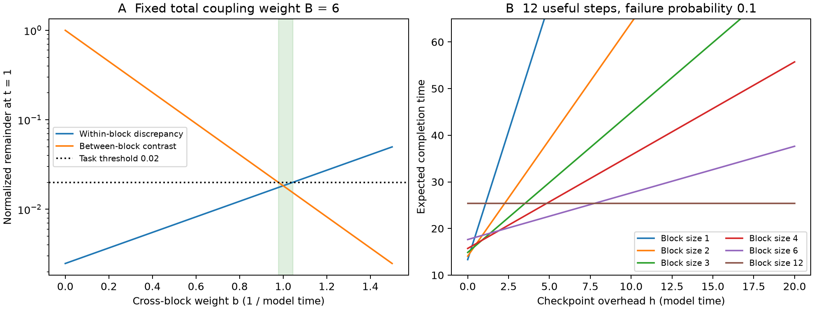

# Q4 模块收益与接口负担的最小模型

日期：2026年11月11日。以下是本项目构造的两个解析模型，用于比较机制，不是自然组织或企业的数据拟合。模型分别研究中断后的返工与固定预算下的动态耦合，没有将两者合并成一个通用成本函数。

[程序](../examples/modularity-models.py)同时生成[完整数值](../examples/modularity-results.json)与[图示](../examples/modularity-tradeoffs.png)，并保留[可编辑 SVG](../examples/modularity-tradeoffs.svg)。文献与模型条件的关系见[阅读笔记](05-reading-notes.md)。

## 稳定中间成果与返工

### 前提和比较对象

完成同一任务需要 N 个有效步骤，每次尝试耗费一个模型时间单位。每一步以概率 p 失败，尝试相互独立；失败耗费这一个时间单位，并使当前未保存段的进度归零。

比较整项任务完成后才保留结果，以及每完成 s 步就保存一段，其中 s 整除 N。已经保存的结果不再损失，段与段能够正确组合；每个内部检查点耗费确定时间 h，期间不发生中断。末段完成后没有另加保存时间。

这里的稳定保存与兼容性是前提。它们没有由模块这一名称推出；实际系统若需维护中间成果、会共同失效或存在组合错误，必须增加相应机制。分段也不要求一棵多层树，不能将本例称为层级必要性的证明。

### 期望完成时间

令 q=1−p。等待连续 n 次成功尝试的期望时间为：

\[
E_n=\frac{q^{-n}-1}{p},\qquad 0<p<1;
\qquad E_n=n\quad(p=0).
\]

可从状态方程得到：完成 i 步后的剩余期望满足 e_i=1+q e_{i+1}+p e_0，e_n=0。解出 e_0 即上式。

等长分段的总期望时间为：

\[
T_s=\frac Ns E_s+\left(\frac Ns-1\right)h.
\]

所以分段优于不分段的条件是：

\[
E_N-\frac NsE_s>\left(\frac Ns-1\right)h.
\]

左侧是这个模型中的返工节省，右侧是新增检查点时间，单位相同。在 p=0、h>0 时分段没有返工收益，只增加开销。若中断发生在保存期间或已保存段也会失效，上式不再是相同模型的结果。

### 已核算的比较

取 N=12、p=0.1，候选 s 为 1、2、3、4、6、12。每个方案完成相同的 12 个有效步骤。

| 每个检查点耗时 h | 候选中最优段长 s | 最优期望时间 | 不分段的期望时间 |
|---|---:|---:|---:|
| 0 | 1 | 13.333333 | 25.407062 |
| 1 | 4 | 17.724737 | 25.407062 |
| 5 | 6 | 22.633528 | 25.407062 |
| 20 | 12 | 25.407062 | 25.407062 |

保存更贵时，最优方案从细分逐步转向更长的段。这里的最优只针对已列的等长候选和这些参数；不包含所有不等长分段、并行方式或实际装配结构。

程序还比较 p=0、0.001、0.01、0.05、0.2。闭式表达与状态方程使用有理数逐项核对。这是期望值的精确计算，没有把单次完成时间或固定工期的成功概率当成同一个指标。

## 固定连接预算下的局部与整体动态

### 系统与预算

四个相同节点，候选划分 A={1,2}、B={3,4}。各组内部一条无向边，权重 a；组间四条无向边，权重均为 b。状态 x_i 的更新为：

\[
\dot x_i=\sum_j w_{ij}(x_j-x_i),\qquad a,b\ge0.
\]

状态可表示相对于共同基准的扰动，各节点容量取相同常数并归一化。权重单位为模型时间的倒数。固定无向边权之和：

\[
2a+4b=B,\qquad a=(B-4b)/2,\qquad0\le b\le B/4.
\]

这表示同类连接能力的分配约束；没有建立制造成本或能量收支，也没有把 B 解释为焦耳、资金或每秒 bit 数。候选划分固定用于比较，参数变化后不保证它仍是内部强、外部弱的结构模块。

### 可以分别推导的结果

组内差异 u_A=x_1−x_2、u_B=x_3−x_4 按以下速率衰减：

\[
\dot u_A=-(2a+2b)u_A,\qquad
\lambda_{\rm local}=2a+2b=B-2b.
\]

组均值之差 d=\bar x_A−\bar x_B 则满足：

\[
\dot d=-4bd,\qquad\lambda_{\rm global}=4b.
\]

因此在固定 B 下，增大跨组权重会加快组均值协调，同时因组内资源减少而减慢组内差异的消除。若保持 a 不变再增大 b，组内速率也会提高；那是增加总预算的另一种比较，不能混淆。

全体均值守恒。取 V=\frac12\sum_i(x_i-\bar x)^2，有：

\[
\dot V=-\sum_{i<j}w_{ij}(x_i-x_j)^2\le0.
\]

当网络连通时，它最终达到一致。最慢非零衰减率为 min(4b,B−2b)，在本组允许的权重中以 b=B/6 最大，此时 a=b，所有六条边相同。可见最适合全局一致任务的方案在此不呈现明显的两组模块结构。

### 明确任务和期限后的比较

分别要求某个非零初始组内差异和非零组均值差，在 T=1 时降至各自初值的 2% 以下。B=6。

| b | a | 组内差异剩余比例 | 组均值差剩余比例 | 组内任务 | 组间任务 |
|---:|---:|---:|---:|---|---|
| 0 | 3 | 0.002479 | 1.000000 | 达标 | 未达标 |
| 0.05 | 2.9 | 0.002739 | 0.818731 | 达标 | 未达标 |
| 0.5 | 2 | 0.006738 | 0.135335 | 达标 | 未达标 |
| 1 | 1 | 0.018316 | 0.018316 | 达标 | 达标 |
| 1.4 | 0.2 | 0.040762 | 0.003698 | 未达标 | 达标 |
| 1.5 | 0 | 0.049787 | 0.002479 | 未达标 | 达标 |

一般地，给定组内阈值 ε_L、期限 T_L，组间阈值 ε_G、期限 T_G，两个任务同时满足要求需：

\[
\frac{\ln(1/\varepsilon_G)}{4T_G}\le b
\le\frac{B-\ln(1/\varepsilon_L)/T_L}{2},
\]

还要与 0≤b≤B/4 取交集。上述数值中可行区间约为 [0.978006,1.043988]。若交集为空，在这个预算和模型族中就没有同时达标方案；重新命名模块无法改变这一点。

### 扰动隔离只能按时间和指标判断

令初态为 (1,0,0,0)，即向节点 1 注入一个单位扰动，之后不持续注入。另一组的均值为：

\[
\bar x_B(t)=\frac{1-e^{-4bt}}4.
\]

减小 b 会降低给定有限时间内的远端平均扰动。但只要 b>0，长期仍趋向 1/4；弱耦合在这里延缓传播，没有永久切断传播，也没有主动修复损伤。这里的连续状态扰动不等于节点故障，不能从这个式子直接声称降低了真实企业破产或生物死亡概率。

## 粗粒化何时保留动态

在对称四节点模型中：

\[
\dot{\bar x}_A=2b(\bar x_B-\bar x_A),\qquad
\dot{\bar x}_B=2b(\bar x_A-\bar x_B).
\]

均值动态精确闭合，是因为每个节点具有相同的跨组权重总和；即使 a 不大也成立。若还想用均值近似各组内部状态，则需要内部差异已衰减。b 很小时，1/(B−2b) 与 1/(4b) 分别给出快、慢时间尺度，能够出现内部已接近均匀、组间仍不同的观察区间。

所以精确闭合与时间尺度分离需要分别判断。并非所有粗粒化都自动产生封装，也不能把一次数学求平均当成真实接口的建立。

一个失效例子：保留两条组内权重为 1 的边，只让节点 1 与 3 之间有权重 c=0.2 的跨组边。微观初态 (1,−1,0,0) 与 (0,0,0,0) 的两个组均值都是零，但前者组均值导数为 (−0.1,0.1)，后者为 (0,0)。仅凭当前两个均值无法决定下一步。这是闭合问题的对照，不作为前述相同预算比较的一行数据。

## 核算与用途

程序独立核对四个解析特征模式、守恒量、V 的衰减式和扰动传播式，并用四阶 Runge–Kutta 对一般初态比较解析解。步长 0.001 的终点最大差异约为 1.10×10^−13，步长减半比较差异约为 1.65×10^−12；这些数值检查说明指定计算一致，不说明现实系统采用这些方程。

左图的绿色区间满足两个任务期限；右图说明检查点开销如何改变可选分段的成本。两图来自不同模型，纵轴不是共同的组织量。

本轮得到的条件性结论是：中间成果的稳定性能改变返工范围，连接预算和跨组动态会产生任务权衡。模块形成的演化轨迹、接口维护、故障修复与社会激励仍需要相应机制。两模型都没有推导层级必然形成、协调成本必为 N² 或 N log N，也没有证明增加模块数必然提高效率。
