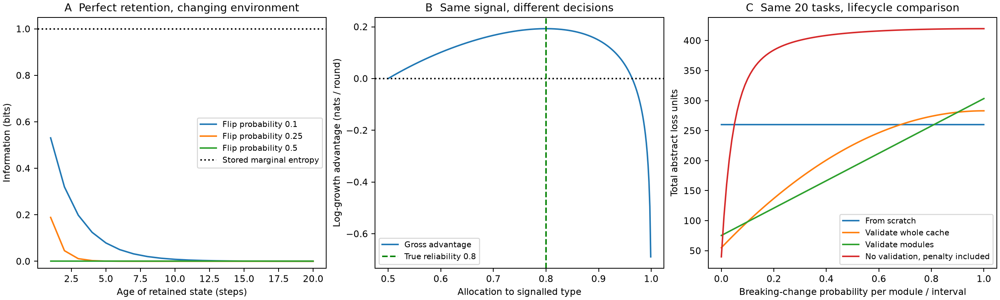

# Q5 记忆预测与复用的最小模型

日期：2026年11月11日。三组有限模型分别考察记录的预测力、行动策略和复用的全周期代价，另以简单概率对照说明共享错误。变量与参数由本项目给定，没有现实组织数据或物理存储器实现。

[程序](../examples/memory-reuse-models.py)生成[完整结果](../examples/memory-reuse-results.json)、[图示](../examples/memory-reuse-tradeoffs.png)和[可编辑 SVG](../examples/memory-reuse-tradeoffs.svg)。文献中的结果与本例的条件分别见[阅读笔记](06-reading-notes.md)。

## 保存不变的记录与变化的环境

环境 X_t 是取值 0、1 的平稳对称 Markov 链，每步以概率 r 翻转。系统准确保存 k 步前的状态 M=X_(t−k)，不再更新，也不发生物理记忆错误。

跨 k 步保留同一值的概率为：

\[
p_k=P(X_t=M)=\frac{1+(1-2r)^k}{2}.
\]

由于平稳分布均匀，H(M)=1 bit 始终不变，但对当前状态的信息为：

\[
I(M;X_t)=1-h_2(p_k),
\]

其中 h_2 是二元熵。直接照抄记录的正确率为 p_k；知道真实转移规律且允许选择反向解码时，最佳二元判断正确率为 max(p_k,1−p_k)。

| 翻转概率 r | 记录年龄 k | 记录熵，bit | 关于当前状态的互信息，bit | 照抄正确率 |
|---:|---:|---:|---:|---:|
| 0.1 | 1 | 1 | 0.531004 | 0.900000 |
| 0.1 | 5 | 1 | 约 0.0789 | 0.663840 |
| 0.1 | 10 | 1 | 约 0.00833 | 0.553687 |
| 0.5 | 1 | 1 | 0 | 0.500000 |
| 0.9 | 1 | 1 | 0.531004 | 0.100000 |

最后一行不是记录没有信息：反向解码可达到 90%。这延续 Q3 的“信息与使用方式”区别；本轮新增的是记录年龄与环境转移机制。表中近似值以结果文件为准。

这个模型说明预测效用可以因为环境变化而衰退，即使保存内容本身完好。它没有证明物理存储器必然衰减，也没有证明所有知识都按这个速率过时。

### 预测了无关部分的情况

令环境由独立的 U、V 两部分组成：U 每步独立公平取值；V 的翻转概率为 0.1。保存上一时刻的 V，对下一时刻完整环境提供约 0.531 bit 信息。但如果任务只要求判断当前 U，最佳正确率仍为 50%。

因此环境整体的可预测信息，与指定任务可用的信息，还要分别判断。若获取该记录有成本而任务不变，这条信息路径没有提供相应任务收益；允许免费忽略时，最优策略可以不用它。

## 同一信号与不同分配策略

采用受 L28、L30 启发的最小对数增长模型。环境有两个等概率状态，线索以概率 p=0.8 指向真实状态。每轮将总量按比例 q 和 1−q 分配到线索所指的类型及另一类型；只有匹配环境的类型保留，并乘以共同正因子 f。讨论的是理想连续群体的增长，不是有限个体死亡概率或投资建议。

相对于始终各分一半，期望对数增长增益为：

\[
g(q)=p\ln(2q)+(1-p)\ln[2(1-q)].
\]

它在 q=p 时最大，且：

\[
g(p)=\ln2-h_{\rm nat}(p)=I(X;Y),
\qquad g(p)-g(q)=D(\operatorname{Bern}(p)\Vert\operatorname{Bern}(q)).
\]

上述信息与 KL 使用 nat，增益单位为每轮对数增长。f 在相同基准的差中抵消；这不说明任意任务的收益与环境回报无关。

| 向线索所指类型分配的比例 q | 相对无信息基准的每轮对数增长增益 |
|---:|---:|
| 0.5 | 0 |
| 0.6 | 0.101229 |
| 0.8 | 0.192745 |
| 0.95 | 0.052966 |
| 0.99 | −0.235927 |

线索质量没变，过度集中的行动却可能低于基准。若每轮实施信息机制另使对数增长减少 c，则净增益为 g(q)−c；必须用相同单位计算这个扣减。它不是将任意焦耳或价格直接从信息量中减去。

本例假定正确的信号质量已知，并给定可行策略。它没有解释系统如何学到 p、环境突然变化后如何更新，或策略的实际物理代价。关于这些实施条件，L30 也明确保留研究空间。

## 相同任务的全周期复用

### 前提与策略

连续执行 H 次任务，每次需要两个正确子成果；从零生成它们的总代价 C，每次运行代价 e。任务间，每个子成果独立以概率 d 发生使旧版本失效的改变。旧版本不会自行重新有效；更新后获得正确新版本。

所有代价使用同一抽象损失单位，错误输出的代价 L 是另外声明的评价权重。初次生成正确，此后比较：

1. 每次从零生成。
2. 保留整项成果，不检查，也不更新。
3. 每次检查整项成果，发现任一子成果失效就全部重建。
4. 逐模块检查，只更新失效部分，再支付组合开销。

检查被假定能无误判断有效性；更新被假定总能得到正确结果；模块局部变化不会破坏另一个模块或组合约定。检查和局部更新的可行性是模型条件，不能从模块这个名称直接推出。

第 2 种策略允许错误，第 1、3、4 种在这些假设下均输出正确。若要求可靠履约，应先比较后三者的成本，再另外评估允许错误的策略。d=0 且这一点已知时，不检查也不会出错；不能在该特殊情形称检查方案为所有策略中的最优。

### 成本公式

令 s=(1−d)^2 为一次间隔后两个子成果均仍有效的概率。整项缓存的初始整理开销为 F_w，每间隔维护 m_w，每次后续检查 v_w。

\[
T_0=H(C+e),
\]

\[
T_w=C+F_w+He+(H-1)[m_w+v_w+C(1-s)].
\]

整项缓存相对从零生成有净节省，当且仅当：

\[
F_w<(H-1)[Cs-m_w-v_w].
\]

因此需要正的单次节省余量，并有足够多使用次数来抵消初始整理投入。若 Cs≤m_w+v_w，延长使用期也不能使这条固定策略获得正节省。

逐模块方案令初始开销为 F_m，每次组合开销 g，每间隔总维护 m_m、总检查 v_m。每个模块重建代价 C/2，期望重建代价为 Cd：

\[
T_m=C+F_m+H(e+g)+(H-1)(m_m+v_m+Cd).
\]

它避免全部重建，却增加了整理、检查或组合开销，所以不保证总优于整项缓存。

不检查的旧版本在第 t 次使用正确的概率为 s^(t−1)，期望错误次数为：

\[
N_{\rm wrong}=\sum_{t=1}^{H}[1-s^{t-1}].
\]

其不含错误代价的投入为 C+F_w+He+(H−1)m_w；若每次错误额外计 L，则再加 L N_wrong。这里错误代价只计损失，没有暗中替系统更新旧版本。

### 数值比较

取 H=20、C=12、e=1、F_w=4、m_w=0.2、v_w=0.8、F_m=7、m_m=0.4、v_m=1.2、g=0.3、L=20。参数仅用于演示，未从行业数据估计。

| 每模块每间隔失效概率 d | 每次从零 | 检查整项并更新 | 逐模块检查更新 | 不检查的期望错误次数 | 不检查且计错误损失的总代价 |
|---:|---:|---:|---:|---:|---:|
| 0 | 260 | 55.0000 | 75.4 | 0 | 39.8000 |
| 0.01 | 260 | 59.5372 | 77.68 | 3.3654 | 107.1083 |
| 0.1 | 260 | 98.3200 | 98.2 | 14.8146 | 336.0927 |
| 0.3 | 260 | 171.2800 | 143.8 | 18.0392 | 400.5843 |
| 0.8 | 260 | 273.8800 | 257.8 | 18.9583 | 418.9667 |
| 1 | 260 | 283.0000 | 303.4 | 19 | 419.8000 |

任务很稳定时，整项缓存的较低开销有优势；部分经常失效时，局部更新有价值；所有部分每次均失效时，两种检查复用方案都更贵。H=1 时没有再次使用，初始整理开销也难以回收。程序同时计算 H=1、2、5、100 的情况。

这些是固定策略之间的比较。允许不建库、停用旧库或改变策略时，最佳可选方案可以退回从零生成；不能据某个强制复用策略较差，断言可选择的信息或复用机会本身必然有害。

### 检索方式也进入成本

补充一个明确的顺序检索例子：库中 K 个候选，恰有一个相关且位置均匀，逐个检查的代价为 a。找到该候选的期望额外成本为 a(K+1)/2。

在前述整项缓存比较、d=0.1、a=0.2 时，K=1、10、100 的额外检索成本为 0.2、1.1、10.1，对应单次复用节省余量为 8.52、7.62、−1.38。加入大量无关候选可以使这条检索方式不划算。

该结果依赖线性查找及候选分布；建立索引、准确筛选或允许忽略候选，会改变结论。这不是所有知识库的规模成本律。

### 更新与切换的未来成本

设已建立的旧方案每次未来使用的可避免成本为 b，新方案为 a，迁移及兼容处理需一次性成本 K，剩余使用次数 R 已知。其他质量与条件相同，切换比继续使用更省的条件是 R(b−a)>K。

取 b=5、a=3、K=5：剩余一次时继续使用较省，剩余十次时切换较省。已经付出的初始整理费无论是 0 还是 100，都不改变这次比较；该费用在全周期评估中计入一次，不应在切换决策中再次当成新增损失。

这个式子说明转换成本与剩余期限怎样影响选择。若历史形成的接口或技能改变了 K 和可行选择，才引入相应的路径依赖机制；仅保存旧记录或曾经投入很多，不足以证明存在不可逃离的锁定。

## 共享错误与独立错误

10 个使用者，各自遇到错误的概率都为 ε=0.01。比较一种共同错误同时影响全部使用者，以及不同版本的错误相互独立。

两者的期望受影响人数都为 Nε=0.1；独立错误下人数方差为 Nε(1−ε)=0.099，共同错误下为 N²ε(1−ε)=0.99。全部受影响的概率分别为 ε^N=10^−20 与 ε=0.01。

这只比较误差相关结构，没有证明独立重复开发能够保持相同错误率，也没有计入共享验证可能降低 ε 的收益。它说明只看平均损失会遗漏共同失效风险；复制次数、验证和多样性需要一起描述。

## 核算与图示

记忆模型用二态转移矩阵逐步计算核对闭式；策略模型核对 KL 损失恒等式；复用模型用有理数枚举每间隔四种变化事件，并以独立失效状态递推核对几何和；共享错误核对完整人数分布的期望和方差。对数计算使用浮点容差 10^−12，其余明确的有理数恒等式精确比较。

三图分属不同模型与单位，没有共同的 Ordo 纵轴。图中信号规律已知、检查完美等简化保留在公式条件中；现实的学习、非平稳变化、误检和共同失效需要扩展模型。
