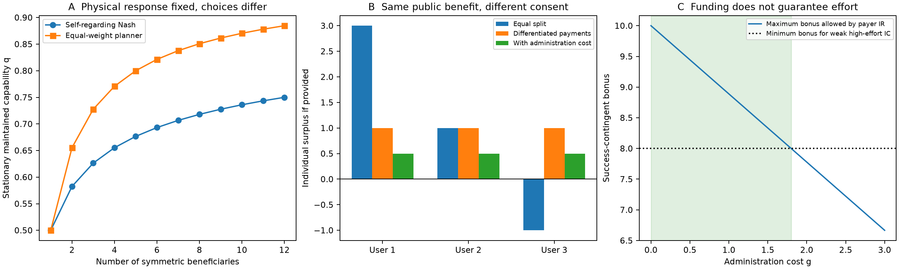

# Q6 最小模型：能力、参与与激励

日期：2026年11月11日。以下是本项目自建的说明性模型，不是实证估计，也不是新发现的通用定律。理论定位见[Q6 专题](07-economic-bridge.md)，文献背景见[阅读笔记](07-reading-notes.md)。

复核文件：[计算过程](../examples/economic-bridge-models.py)、[数值结果](../examples/economic-bridge-results.json)、[PNG](../examples/economic-bridge-tradeoffs.png)及[SVG](../examples/economic-bridge-tradeoffs.svg)。运行计算文件会重新生成结果和图。维护模型使用二分法核查稳态及一阶条件；支付和离散博弈使用有理数精确计算。

图 A 是稳态能力比较；图 B 是假定已经供给时各人的净收益，负值表示相应参与约束失败；图 C 的阴影表示所设成功奖金合同存在弱激励可行区间。三图不能合成一个普适优劣指标。

## A 相同维护规律，不同投入行为

设能力状态满足无量纲方程：

\[
\dot q=E(1-q)-q,\qquad E=\sum_{i=1}^{n}e_i,\qquad e_i\geq0.
\]

给定持续投入，稳定状态为 \(q^*=E/(1+E)\)。这是特设的现象学维护规律，没有能量守恒推导或价格换算。以下只比较长期恒定投入的稳态；没有计算初始建设、过渡路径、贴现及资金周转。

新增经济假设：n 人都从同一能力受益，彼此的使用不减损能力；各人知道模型和他人的收益结构，只关心自身收益，且可独立选择努力。货币等价净收益定义为：

\[
u_i=bq^*(E)-\frac{e_i^2}{2},\quad b>0.
\]

努力是无量纲投入，平方项是设定的机会成本，不能与焦耳等同。严格凹的个人目标给出最优反应；对称纳什均衡满足：

\[
e_N=\frac{b}{(1+ne_N)^2}.
\]

若另行选择等权加总 \(W=\sum_i u_i\) 作评价基准，严格凹的总体目标有唯一最优解。对称解满足：

\[
e_P=\frac{nb}{(1+ne_P)^2}.
\]

两式左侧改写为严格递增的 \(e(1+ne)^2\)，所以 n>1 时 \(e_P>e_N\)。这一步依赖收益外溢与所设目标，不是第二定律的推论。

| n=4，b=4 | 每人努力 | 总努力 | 稳态能力 q | 每人净收益 | 合计 W |
|---|---:|---:|---:|---:|---:|
| 只关心自身的纳什均衡 | 0.475270 | 1.901080 | 0.655301 | 2.508262 | 10.033050 |
| 等权总体最优 | 0.840661 | 3.362643 | 0.770781 | 2.729769 | 10.919077 |

在总体最优处，若另外三人维持投入，单人改为努力0.277137可把自身收益提高至2.908722。因而“所有人都比原均衡好”仍不代表该投入组合在现有规则下具有个人激励。

动机敏感性：把个人目标改成 \(u_i+\lambda\sum_{j\ne i}bq\)，意味着对他人收益赋权，其他人的成本对本人选择是常数。对称条件中的 b 变成 \(b[1+\lambda(n-1)]\)。n=4 时：

| 对他人收益权重 λ | 0 | 0.25 | 0.5 | 1 |
|---|---:|---:|---:|---:|
| 稳态 q | 0.655301 | 0.706672 | 0.735999 | 0.770781 |

这不证明现实人具有何种 λ，而是说明动机假设会改变结论。不能把完全自利或完全利他升级为通用组织公设。

## B 总收益足够，分摊与协调仍有区别

三名使用者对一项可共同使用成果的价值为 \(v=(6,4,2)\)，一次供给的真实成本 C=9。设价值与成本均已换到同一货币等价尺度，且可作准线性加总，忽略财富效应、风险与外部第三方。总收益12大于成本9，是本模型的正净收益条件。

### 一次性贡献博弈

每人同时选支付 \(x_i\in\{0,1,\ldots,9\}\)，总支付达到9才供给；不足时已经支付的贡献不退回。设收益：

\[
u_i=v_i\mathbf1\{\sum_jx_j\geq9\}-x_i.
\]

该不退款规则是模型的一部分，不能套用于退款承诺、重复互动或已有组织的机制。枚举1000个组合及所有单人偏离，得到10个纯策略纳什均衡：

- 一个不供给均衡：(0,0,0)。每人单独承担全部9都不合算。
- 九个供给均衡：(3,4,2)、(4,3,2)、(4,4,1)、(5,2,2)、(5,3,1)、(5,4,0)、(6,1,2)、(6,2,1)、(6,3,0)。

供给均衡的支付正好为9，且各人支付不超过其价值。有人降低支付会导致项目不成立，因而没有严格有利的单人偏离；部分人可能无差异。相同结论对这些组合在非负连续支付下也成立。这个例子同时说明可能不供给与可能供给，不能推导自愿合作必然失败或必然成功。均衡选择与建立承诺的过程尚未建模。

### 预算平衡不等于人人愿意参加

以下另比较供给协议；表中净收益是假定供给已经实现的条件值，不是上一博弈在任意支付组合下的预测。

| 协议 | 各人支付 | 各人净收益 | 供给方净额 | 总净收益 |
|---|---|---|---:|---:|
| 等额分摊 | (3,3,3) | (3,1,−1) | 0 | 3 |
| 差异分摊 | (5,3,1) | (1,1,1) | 0 | 3 |
| 加管理成本 g=1.5 | (5.5,3.5,1.5) | (0.5,0.5,0.5) | 0 | 1.5 |

若协议要求三人一致同意、各人退出导致不供给，且退出收益为0，等额方案中第三人会拒绝。差异方案满足这种参与约束，但找到和实施方案仍需机制。若管理成本变为4，则总成本13超过总价值12；在这些边界、无外部补贴、退出收益0的条件下，不存在兼顾各方非负净收益和预算平衡的支付。

一般会计恒等式为：

\[
\underbrace{\sum_i(v_i-p_i)}_{使用者净收益}
+\underbrace{(\sum_i p_i-C-g)}_{供给方净收益}
=\sum_i v_i-C-g.
\]

在包含收付款双方的边界内，转移支付抵消；不可既把支付全算作社会损失，又重复减去它所购买的真实投入。反过来，转移支付对谁能出资、谁能获益十分关键，抵消并不使分配问题消失。实际经济中的价格、税收、财富与外部影响还需要更完整模型。

### 公开公式不保证如实申报

设按申报价值 r 比例收费 \(p_i=9r_i/\sum_jr_j\)，申报合计至少9就供给。所有人如实申报(6,4,2)时收费(4.5,3,1.5)，第一人真实净收益1.5。若第一人改报4，申报变成(4,4,2)，收费为(3.6,3.6,1.8)，供给仍成立，第一人真实净收益变成2.4。

这是对该特定规则不具备如实申报激励的反例。它没有证明所有价值申报机制都不可行。可见、可核验、可执行，以及愿意如实申报，是不同要求。

### 附加比较：有排除能力也不等于必能融资

保持价值(6,4,2)，假定可以无成本、完全有效地排除不付费者，供给者只能收统一访问价，消费者在价格等于价值时购买。候选价格2、4、6的收入分别为6、8、6。

成本9时统一访问费无法独立融资，虽然开放使用的总价值为12。成本7时定价4可融资：两人使用，供给者利润1、消费者净收益合计2，总净收益3；如果有办法融资并让三人使用，则总净收益为5。

这是限定价格机制和理想排除技术的比较，不是私人供给不可能定理。差异定价、捆绑、补充服务与赞助都可能改变结果；开放方案同样要计入实际融资与执行成本。

## C 筹到钱不等于努力会被执行

设一名维护者可以选高努力 H 或低努力 L：成本分别4、0；成功概率分别0.9、0.4。支付者在成功时获得价值10，失败时为0。努力不可观察，成功可以观察且可据以执行支付。双方知道概率、风险中性、退出收益为0；奖金非负、失败支付为0。此处没有为可执行性本身提供经验保证。

固定支付4虽覆盖高努力成本，但维护者选 H 得0、选 L 得4，所以不会因该支付而选择 H。

若成功才付奖金 w，激励条件（IC）是：

\[
0.9w-4\geq0.4w,\quad\text{即}\quad w\geq8.
\]

w=8 只是无差异；要严格激励 H 需 w>8，或另说明可信的平局选择规则。设管理成本 g 由支付者承担，其参与约束（IR）为：

\[
0.9(10-w)-g\geq0,\quad w\leq10-g/0.9.
\]

维护者在 H 下的参与条件为 \(0.9w-4\geq0\)，弱于此例的 IC。

| 管理成本 g | 激励所需最低奖金 | 支付者可接受最高奖金 | 此类合同的可行性 |
|---|---:|---:|---|
| 0 | 8 | 10 | 存在严格激励区间 |
| 1 | 8 | 8.888889 | 存在严格激励区间 |
| 1.8 | 8 | 8 | 只有弱激励边界 |
| 2 | 8 | 7.777778 | 无可行区间 |

例如 w=8.2，维护者的 H 与 L 收益分别为3.38、3.28，预期支付7.38，支付者在 H 下净收益为 \(1.62-g\)。成功时要实际付出8.2，预期支出7.38不是每种结果下的现金需求。

结论只适用于这类单维护者、单期成功奖金合同。努力可核验、多期声誉、担保、风险厌恶、多名维护者或不同支付规则均需重做。不能把“此合同族无解”扩大成所有制度都无解，也没有在这里复现 Holmström 的团队定理。

## 本轮模型支持的有限判断

1. 给定维护规律后，行为假设与互动规则仍会改变实现的能力水平。
2. 正总净收益、预算平衡、各方参与及所需行动的激励相容彼此不同。
3. 支付、努力、产出、价值和分配主张需要分别建模；总额公式不能代替它们之间的机制。

这些结果足以设计 Q7 的比较标准，尚不足以选出最优现实融资制度。跨期维护、质量度量、多任务、异质动机、信息学习及实际治理成本仍未纳入。
