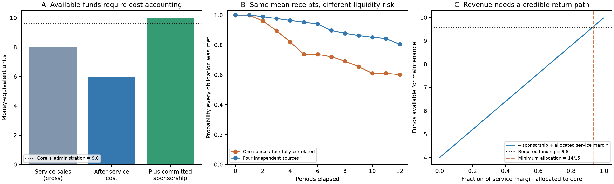

# Q7 模型 条件筹资 净额回流与多期预算

日期：2026年11月11日。以下是本项目的说明性模型，参数均为假设。文献背景见[阅读笔记](08-reading-notes.md)，机制解释见[Q7 专题](08-open-funding.md)。

可复核文件：[计算过程](../examples/open-funding-models.py)、[数值结果](../examples/open-funding-results.json)、[PNG](../examples/open-funding-tradeoffs.png)、[SVG](../examples/open-funding-tradeoffs.svg)。有限博弈穷举每个行动组合及所有单人偏离；资金与概率用有理数计算，跨期模型逐期传播全部存续余额状态。

图 A 第一根柱只是服务营业收入，扣除交付成本后才得到第二根柱；第三根加入承诺赞助。图 B 固定初始储备9.6，绘制截至各期从未拖欠维护支出的概率；图 C 比较承诺赞助4、服务净额6中不同回流份额。曲线均不是现实估计。

## 共同维护目标与核算口径

同一公开成果每期需要维护劳动6、其他投入3、管理0.6，总资金需求9.6。劳动6既是设定的机会成本，也假定为支付给维护者的保留报酬；实际支付不是额外再加一次社会成本。相对既有公开成果，达到本期维护目标给三名使用者的增量价值为(6,4,2)。旧版继续开放，筹资失败不撤回使用权。

这是固定任务、固定质量和货币等价效用的基准。它省略维护质量的连续变化、财富效应和贴现。单期筹资、补充服务与随机多期预算分别检查不同环节，没有把它们拼成已证明激励相容的完整制度。

## A 固定报价 退款与失败奖金

三名指定参与者分别收到(5.3,3.3,1.3)的报价，每人只可接受或拒绝，必须三人全部接受才供给本期维护。筹成共9.9，足以覆盖9.6并给组织者留下0.3；每位使用者的增量净收益为0.7。

筹资失败时退还全部承诺款；另外，组织者已支出的活动成本0.2不能退回。该0.2是管理0.6的一部分，余下0.4仅在筹成后支出。先假定签约没有个人成本，承诺可执行，价值、成本和人选已知，拒绝导致失败时增量收益为0。

### 只有退款

失败时接受者与拒绝者都得0。普通纳什均衡共五个：(0,0,0)、(1,0,0)、(0,1,0)、(0,0,1)、(1,1,1)。其中1表示接受。

全体接受可以供给；如果至少还有一人拒绝，单个接受可能仍不能使项目成立，因此有不供给的弱均衡。退款去除了贡献款被浪费的一种风险，却没有在此博弈中选出唯一行动结果。这与 Bagnoli–Lipman 使用特定精炼的结果不同，不能据本例否定其定理。

### 失败时给接受者奖金0.1

若其他两人都接受，接受得0.7，拒绝使项目失败而得0；若其他人没有全部接受，接受可以拿0.1，拒绝得0。因此接受成为严格优势策略，唯一均衡是全体接受。这是本例固定名单、全体必要、报价已知和可执行条件下的结论，不是任意众筹的保证。

奖金由组织者承担。失败最多有两人已接受，其奖金支出最多0.2，加不可回收活动成本0.2，需自有担保资金0.4；参与者原承诺款应另行保管并全额退回，不能拿来付奖金。

若引入额外的实际筹资失败风险，以成功概率 p、失败均按最坏0.4支出作保守预算，则组织者预期净额为：

\[
0.3p-0.4(1-p),\qquad p\geq4/7
\]

才非负。这是外加风险下的预算边界，不是前述完全信息博弈内生给出的成功概率；担保承诺若不可信，接受收益也会改变。

### 签约成本改变结果

每个接受者另耗费时间，按同一效用尺度计0.15，无论筹成与否都承担。失败时接受的净收益变成−0.05，成功时为0.55。此时全拒绝与全接受都是均衡，严格优势策略消失。

所以即使失败奖金规则明确，实际签约、核验和操作负担仍需比较。不能把交易操作成本当成奖金机制之外无关紧要的细节。

## B 服务收入怎样变成维护资金

维持同一开放核心，设三人对额外专属支持服务的增量价值为(5,4,2)，每服务一人的成本为1。服务可排除，公开成果的使用不以购买服务为条件。给定核心已得到可信融资，客户在价格等于其服务价值时购买。

| 统一服务价 | 客户数 | 营业收入 | 服务交付成本 | 服务净额 | 相对维护需求9.6的缺口 |
|---|---:|---:|---:|---:|---:|
| 2 | 3 | 6 | 3 | 3 | 6.6 |
| 4 | 2 | 8 | 2 | 6 | 3.6 |
| 5 | 1 | 5 | 1 | 4 | 5.6 |

最好服务净额仍只有6。营业收入8不能全部用于维护，也没有因成果开放而自动消除资金缺口。若服务还有销售、人事、资本及退款成本，需继续扣除；本例的服务成本1假定已包含该项交付所需成本。

这只是给定核心可用时的需求和预算筛查。没有求解服务预购、核心融资和用户行动的联合均衡，因而“净额足够”也只是后续机制分析的入口。

### 加赞助仍需明确回流规则

假定已有可执行赞助承诺4，让服务净额6中的份额 α 用于公共维护：

\[
F=4+6\alpha,\qquad F\geq9.6
\Rightarrow\alpha\geq14/15.
\]

全部回流时共10，余0.4可留作储备；只回流一半则只有7，缺2.6。余下未回流部分归谁、以什么条件支配，需要另行约定。

赞助4可由重度使用者提供。例如第一人的维护增量价值6，在“无该固定承诺即不供给”的情境下有支付动机；若退出仍能享受他人供给，外部选择会改变。这里没有证明该人会自发选择4，也没有保证服务卖方愿意承诺 α。数字14/15只由此例成本和收入决定，不能作为 AutoOS 的通用费率。

### 有上限的匹配资金

若捐赠 d 可获得1:1配捐，外部预算上限3，则可用资金为 \(d+\min(d,3)\)。要达到9.6，至少需原始捐赠6.6，而不是无限匹配时的4.8。

匹配预算来自另一付款方；承诺不能重复记入赞助和配捐两栏。此例仅是金额约束，没有证明匹配会增加捐赠，也没有建模挤出、冒名或跨项目分配。

## C 单期均值与持续付款

每期仍需9.6，收入在当期支出前到账，不得借款或额外救助。初始现金储备9.6，余额归集可跨期使用；一旦现金不足，当期目标付款失败，此后不再计作连续履约。旧成果的开放状态不受此定义改变。

比较相同承诺总额12、相同期望实收9.6的三种来源结构：

- 单一来源：每期以0.8概率付12，否则付0。
- 四个独立来源：每个以0.8概率付3，各方本期是否支付相互独立。
- 四个完全相关来源：各方同受一个冲击，合计付12或0。

各期之间独立，维护需求固定；不同来源数的管理成本暂设相同。因此本例不估计真实客户续约或捐款概率，也没有计入增加付款方可能增加的管理成本。

设余额为 B，收入为 F，连续履约要求在每期支出时 \(B+F\geq9.6\)，随后余额更新为 \(B'=B+F-9.6\)。计算全部存续余额及其概率，不用抽样模拟。

| 来源 | 每期期望实收 | 每期收入方差 | 12期内至少一次付款不足的概率 |
|---|---:|---:|---:|
| 单一 | 9.6 | 23.04 | 39.8705% |
| 四个独立 | 9.6 | 5.76 | 19.5202% |
| 四个完全相关 | 9.6 | 23.04 | 39.8705% |

这些概率是模型结果。在当前储备下，独立来源减少了中断风险；名义上有四个付款方但同步流失，则与单一来源完全相同。相同期望收支不保证连续履约。

### 储备不足时 风险排序可能反转

| 初始储备 | 单一来源的12期不足概率 | 四个独立来源的12期不足概率 |
|---|---:|---:|
| 0 | 71.6532% | 83.5809% |
| 4.8 | 60.9158% | 42.6509% |
| 9.6 | 39.8705% | 19.5202% |
| 19.2 | 18.7983% | 1.5879% |

零储备时，四个来源中即使三个付款，收入也只有9，低于本期到期的9.6；第一期必须四个都付才能履约，概率为 \(0.8^4=0.4096\)。单一来源第一期收到足额的概率为0.8。分散虽降低方差，却增加此处第一期的小额不足概率。

因此，不能单凭收入均值、方差或来源数量给持续性排序，需要同时看支付门槛、资金到账时间、储备、相关性和支出弹性。储备本身也需要此前投入，本例没有把它的融资成本或出资者回报算成零成本福利。

## 本轮验证范围

已核验三个有限合同博弈的全部组合与单人偏离、服务净额与回流阈值、匹配上限，以及多期概率质量守恒。图中采用一期间储备，表中另保留零储备反例。

模型没有重做 Q6 的隐藏努力合同，没有证明出资后一定达到维护质量，也没有加入策略性拒付、共同衰退、任务选择、贡献分配或实际退出数据。融资安排通过预算核算后，仍需接受这些检验。
