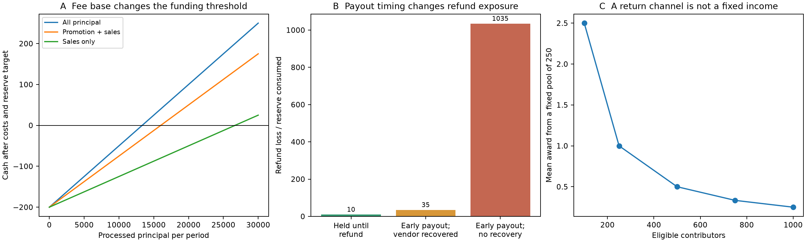

# Q8 模型 AutoOS 的收费 回馈与维护预算

日期：2026年11月11日。以下是自建核算和反例，5%及50%来自历史候选方案；其余金额、成本率、人数与行为均为说明性假设。没有使用真实经营数据，也没有接入支付系统。

对应[应用研究](09-autoos-open-business.md)和[来源记录](09-reading-notes.md)。可复核材料：[计算过程](../examples/autoos-business-models.py)、[数值结果](../examples/autoos-business-results.json)、[PNG](../examples/autoos-business-tradeoffs.png)、[SVG](../examples/autoos-business-tradeoffs.svg)。金额使用有理数；实际最小货币单位、舍入及尾差结转需要另定。

## A 收费基数与平台自身预算

设一个期间已结算本金 H=10,000，其中保留1,000、推广2,000、购买及打赏7,000。资源3,000转给相应服务方，销售及打赏7,000转给约定收款者。服务费另加在本金之上；同一底层结算只收费一次，内部归集和分账不重新收费。

若全部本金收费，τ=5%，技术费 S=500；回馈比例 β=50%，公共池250，平台保留250。付款总额10,500守恒为：

\[
10,500=3,000_{资源本金}+7,000_{交易本金}
+250_{公共回馈}+250_{平台保留}.
\]

资源本金和卖方本金不作为平台可以自由花费的服务收入。这里是资金用途核算，不是特定会计准则下的收入确认结论。

如果总价含费而非另加，必须另写口径。例如用户总共只付1,000，若其中5%为费，本金就是950；不能同时承诺卖方获得1,000。本轮主例只使用加收口径。

### 计费范围缩小不消除全部处理成本

假设平台仍承担按全部已处理本金 H 计的变动成本率 v=1%，本期固定运营成本180；另希望增加储备20。v不是支付渠道报价，180不包含已另付的资源本金，储备增加也不是经营费用。

| 收费范围 | 计费本金 E | 技术费 | 公共池 | 平台保留 | 支付假设成本后的现金结余 | 再满足储备目标后的余缺 |
|---|---:|---:|---:|---:|---:|---:|
| 全部本金 | 10,000 | 500 | 250 | 250 | −30 | −50 |
| 推广、购买与打赏 | 9,000 | 450 | 225 | 225 | −55 | −75 |
| 仅购买与打赏 | 7,000 | 350 | 175 | 175 | −105 | −125 |

即使某类资源支付免收技术费，只要仍经过平台处理，就不能自动把相关处理成本当成零。成本到底由哪方承担需要实际支付安排。

设计费比例 f=E/H，固定成本 F，储备增加目标 ΔB，则满足本期预算需要：

\[
[(1-\beta)\tau f-v]H\geq F+\Delta B.
\]

若方括号为正，且各类本金比例、成本率与固定成本都保持本例设定，三种范围的本金门槛分别约13,333.33、16,000、26,666.67。若 \((1-\beta)\tau f\leq v\)，扩大规模本身不能覆盖正的固定成本和储备目标。

在全部收费、H=10,000时，满足本例预算的 β 上限为40%；若H增加到20,000且成本结构保持不变，50%方案才有100的储备目标后余量。这是参数敏感性，既没有认定50%应取消，也没有证明只需扩大交易量就能解决真实预算。

程序另核查同一结算事件重放不会再收一次费。这只是账例中的去重约定，不是防止伪造交易的实现，也不意味同一笔资金用于一项全新真实服务时永不再产生费用。

## B 退款前后分账与追回

假设一笔购买本金1,000、加服务费50，客户共付1,050。按本例政策全额退本金及技术费；处理成本10已经发生且不可收回。其余运营支出忽略，初始风险储备40。

| 结算安排 | 退款后储备 | 消耗的储备 | 原因 |
|---|---:|---:|---|
| 卖方和公共奖励尚未支付 | 30 | 10 | 只有处理成本损失 |
| 已付卖方1,000及公共奖励25；只追回卖方款 | 5 | 35 | 处理成本10及已付奖励25 |
| 两部分均成功追回 | 30 | 10 | 同样只剩处理成本损失 |
| 已付后两部分均未追回 | −995 | 1,035 | 退款前余15，无法回收1,025的已分款 |

负余额表示还需额外995才能完成本例退款，而非系统能凭空支付。程序列出每项收支，守恒可逐项复核。尚未分出资金也不表示无损失或无需储备；已发生、不可收回的成本仍存在。

Stripe 原文只是说明其一种收款转账结构中退款与追回要分别处理；上述全额退款政策、处理成本和可追回情况都是自设场景。实际拒付期限、责任与结算规则须按所选服务另行研究，本例不作地区或法律结论。

## C 固定池有预算上限 仍可能错分

只为检验旧指标的直接乘积版本，设权重为“信息体积代理 I × 收藏数 c”。两份真实贡献的权重分别为80和20，公共池250，原奖励200和50。

一个参与者没有新增本例认可的公共贡献，却用额外身份和一个申报条目制造权重100。其真实不可回收资源支出为1，加技术费0.05；新技术费中的0.025也计入公共池，故池变成250.025。

按权重分钱后，原两份贡献得到100.01和25.0025，制造指标者得到125.0125，减去1.05支出后净得123.9625。所有奖励合计恰等于新池，没有超支，却明显改变分配。

这不是自动盗取真实系统资金的攻击实现，也没有假定未来评分就一定允许这些权重。它检验的是：**仅有实付收藏成本和固定预算，尚不足以证明简单指标分配不可操纵。**本轮没有证明某一身份或审核方法已经解决问题。

本例也没有把 I 当作 Shannon 信息、知识正确性或任务价值。压缩、纠错和修订可能减少体积而改善结果；这与 Q3、Q5 的区分一致。

### 公共回馈通道不等于固定收入承诺

公共池固定250时，合格贡献者100名的平均奖励为2.5，1,000名为0.25，个体并不必然得到平均值。若额外承诺每人每期至少1，在本例全部收费条件下，单就这项承诺便要求：

\[
\beta\tau H\geq N,\qquad H\geq40N.
\]

这还未处理公共池内部的其他用途与管理成本。不能由“每个人都有资格”直接推出足以维持每个人持续劳动的报酬。

## D 保留续费与推广预算

设一份内容每期基础保留成本12，按每位支持者分配的使用成本0.3，共担成本为 \(C(n)=12+0.3n\)。

| 支持者 n | 总成本 | 均摊每人 |
|---|---:|---:|
| 2 | 12.6 | 6.3 |
| 4 | 13.2 | 3.3 |
| 40 | 24 | 0.6 |
| 400 | 132 | 0.33 |

共担可以降低每人负担，同时总资源消耗仍会上升。若从4人变为2人，而剩余者只授权原来的每人3.3，则下一期缺6。不能把上期的收藏计数算成永久付款承诺；需要重新取得预算，或按事先约定降级、迁移和交接。现有本地副本与许可不会因这道预算式自动消失。

再设推广每轮执行服务报价为 \(1+0.02n\)，这是服务供应者含准备投入的报价，不与平台固定运营成本180重复。全部支出另加5%费时：

| 本轮接收人数 | 服务本金 | 技术费 | 合计预算 |
|---|---:|---:|---:|
| 100 | 3 | 0.15 | 3.15 |
| 1,000 | 21 | 1.05 | 22.05 |
| 10,000 | 201 | 10.05 | 211.05 |

首轮即使已凑到资源本金3，也还没有授权含费预算3.15。明确补到3.15后可以执行首轮。假设点赞等表现达到候选阈值，但参与者对下一轮明确承诺的预算仅12，仍不足以执行22.05的下一轮。

表现门槛与预算门槛分别判断。点赞、分享本身不在本例中产生扣款授权；未筹成的金额怎样退回、已发生准备成本由谁承担，应在每轮协议中说明。这里没有用真实传播转化率，也没有证明随机试点能保证宣传真实或总体质量上升。

## 核验范围

已核验本金与费用分配守恒、重复事件费用、三个收费范围及边际成本边界、退款逐笔现金、固定池分配与有利指标操纵，以及续费和推广的含费预算。

模型没有证明真实需求、市场竞争、贡献认定或维护激励成立。真实运营还需分开取得交易本金、费用、退款、实际到账、每项成本、维护履约和合格贡献人数等数据。
