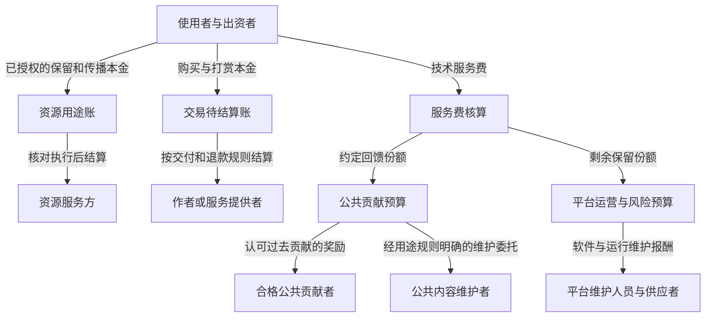

# Q8 AutoOS 开放商业的角色 资金与维护

日期：2026年11月11日。状态：基于用户历史设想的应用研究草案，未定稿为运营规则，也没有认定这些功能已经实现。设计来源与外部依据见[来源笔记](09-reading-notes.md)，计算和失败情形见[模型说明](09-autoos-models.md)，原文见[第九批归档](../../wiki/raw/round-09/README.md)。

后续跨期补充见[研究36](36-credit-investment-feedback-and-maintenance.md)及[资金回流与维护设计](../surveys/03-competition-cooperation-distribution/open-business-finance-and-maintenance.md)，增加启动融资、逐期用途现金、偿付、退款和接替，比较两个未来预算候选版本；不改本阶段历史设想的参数地位，也不表示已经调整运营规则。

## 本轮结论

AutoOS 的候选 Open Business 模式可以描述为：**使用者共同承担内容保留与传播的资源投入，商业参与者通过直接交易获得回报，平台提供有明确收费的共同服务，并按规则将部分服务费回流普通公共贡献。**

这包含资源共担、直接交易、公共贡献支持三种不同机制。它们需要不同的责任与账户：付清存储费没有支付全部创作劳动，形成交易收入没有确定公共回馈，向过去的贡献发奖也没有指定未来维护者。

本轮将上述关系具体化为可讨论的角色、资金与责任安排。5%、50%、首轮100人及信息量与收藏指标保留候选地位；前七轮理论没有唯一推出这些数值或某种分配正当性。

## 1 已有设想与本轮增加的设计

[H02 历史讨论](../../wiki/raw/round-09/H02-open-business-dialogue/conversation.md)中，用户提出保留成本自担及收藏共担、逐轮试点推广、购买与打赏的成本透明、技术服务收费和普通贡献者回馈。后期提出“一切支出收一次5%”和“技术费50%用于普通内容提供者”；收费范围的不同表述尚需统一。

本轮主模型按字面采用全部已结算服务本金另加5%作示例，并与只对推广和交易收费、只对交易收费并算。这个选择用于核算，不代替用户对最终价格口径的决定。历史助手对回馈的赞同，也未被算作用户最终确认。

为使机制可检查，本轮增加：用途账分开、每轮付费授权、贡献来源记录、公共奖励与维护委托分开、付款状态与退款责任、维护验收及交接。这些属于研究建议，不是从旧讨论读出的现成规定。

## 2 开放的对象和边界

| 维度 | 当前候选定位 | 需要明确的条件 |
|---|---|---|
| 内容访问和复用 | 普通知识可以继续分享，内容本身可以零售价 | 哪一版本、哪些使用和复用得到授权；资源服务仍可能有费用 |
| 经营参与 | 用户、作者或第三方可提供内容与服务 | 接入条件、共同服务的使用及收费约定；尚未认定接口已开放实现 |
| 传播机会 | 按共同规则开展试点、扩大传播 | 合格样本、接收者选择、预算与执行证据，不能仅宣称随机即公平 |
| 规则与核算 | 费用、用途和程序可以核对 | 公开规则及必要汇总，私人身份和收款资料保留适当访问限制 |
| 公共贡献回报 | 非直接收费的贡献也有经济支持通道 | 资格、预算、认定、申诉、到账与是否承担后续任务 |
| 治理参与 | 规则有制定、执行和纠错承担者 | 谁决定、谁能修改、怎样回避利益冲突和处理退出 |

“免费内容”在此指内容售价可以为零，不表示保存、访问、验证和维护没有投入。第三方在平台外使用公开成果，也不会因这张账表自动产生可收取的服务费；是否使用共同交易设施并接受其收费条件要分别说明。复制、引用、编辑和经营权限不能由付过保留费直接推定。

## 3 角色及其权利责任

以下是职能划分，同一人可承担多个角色。兼任不应掩盖其付款、受益和评审之间的关系。

| 角色 | 可以作的选择与取得的回报 | 需承担或明确的责任 |
|---|---|---|
| 阅读者与使用者 | 使用授权范围内的成果，选择是否支持保留或传播 | 只有明确同意的预算才进入付费承诺；关注、点赞本身不替代授权 |
| 收藏及保留出资者 | 支持指定版本、期限和保留等级，取得相应服务 | 说明续期上限及退出选择，不被默认视为永久出资者 |
| 内容作者与整理贡献者 | 声明来源、贡献及使用条件；可以获得交易款、打赏或公共回馈 | 上传、创作、整理和校验分别记录，不能把他人的贡献直接申报为本人全部成果 |
| 推广发起者与共同出资者 | 选择试点和是否为下一轮承诺预算 | 承担约定且已授权的传播费用，不凭点赞默认向他人转嫁支出 |
| 付费内容或服务提供者 | 公开报价和履约条件，获得直接结算款 | 对所售版本或服务履约，按协议处理错误说明、退款和交接 |
| 存储及传播服务方 | 对已提供、可核对的资源服务收取约定费用 | 计量、可用性及约定的数据恢复和迁移责任 |
| AutoOS 运营者 | 收取技术费中的约定保留份额 | 维护平台软件、计量、结算、公共接口、运行安全和规则执行所需能力 |
| 公共预算管理职能 | 按规则归集、承诺和拨付公共资金 | 区分待结算、已承诺、可分配、已支付及追回事项，不挪用为未说明用途 |
| 贡献评审与复核职能 | 认定贡献资格、证据及奖励，处理争议 | 公布依据、利益回避和复核程序；评审认可不等于已付款 |
| 受托内容维护者 | 接受限定范围与期限的维护委托，按约定取得报酬 | 提交可验收结果、版本与交接材料；范围外不自动无限负责 |
| 规则制定和申诉职能 | 按约定程序修改规则、解释争议 | 保存版本、说明适用时点，避免将未告知的新规则追溯套到已有承诺 |

平台不经营与用户竞争的内容，是历史设想中的定位。本轮仍按此定位讨论；承担计量和执行职责不等于必须由运营者独自决定内容价值。由谁评审和申诉可以另行组织，但“由社区处理”必须进一步指明实际职能与人员安排。

## 4 四类资金用途与结算状态

图中的账是用途与承诺的逻辑划分，不指定法定托管结构，也没有保证某支付机构支持所需安排。“公共预算支付维护委托”是本轮候选扩展，需限定为合格公共内容工作；不能把原拟给普通贡献者的资金悄悄挪去支付平台自身开发。

四类用途为：资源本金、交易本金、公共回馈、平台自身运营。若另有外部赞助，按限定用途单列，不能重复计入两类收入。内部归集、分账、公共奖励发放不因此再次收取同一底层服务的技术费；新的真实服务则有自己的报价与结算事件。

“收一次5%”还需统一含费或另加口径、计费范围和退款冲销。历史上的“消费税”是收费类比，本研究将其记为技术服务费，不据此判断法律上的税种或代征关系。

### 50% 回馈需要与运营预算一起核算

设已结算计费本金 E，费率 τ，回馈比例 β：服务费为 τE，公共池新增 βτE，平台保留 \((1-\beta)\tau E\)。以5%和50%计算，两部分各为计费本金的2.5%。

资源成本得到另行覆盖，能够减轻平台垫资，但平台仍需从自己的资金承担软件维护、结算、核验及争议处理等未被其他报价覆盖的成本。公共池是已划定用途的预算，不能同时作为这些成本的可用收入。

本轮说明例子中，全部处理本金10,000，平台保留250，假设变动成本100、固定成本180，已经出现30的经营现金缺口；若另希望新增储备20，则缺50。这只证明5%与50%需和实际成本一起检验，没有用虚构参数给出实际收费建议。见[预算模型](09-autoos-models.md#a-收费基数与平台自身预算)。

### 收到 分出与追回要分别记账

候选状态依次包括：授权预算、实际收款、服务执行、待结算、可分配、已付款；退款、撤销、追回失败另作关联记录。付款人余额、供应者应收、公共池预算与平台可用余额不应合并成一个“总余额”。

Stripe 的一种分账结构说明退款不会自动撤回关联转账；Open Collective 的流程也把费用认可与实际支付分开。它们提供需核查的问题，不决定 AutoOS 的渠道选择。具体模型显示，已经分出的公共奖励若不可追回，会额外消耗退款准备；不能只按技术费净额估计风险。约定结算时点之后仍可能发生争议，储备和追回责任需另列。

## 5 贡献者回报分为三条路径

**直接交易回报。** 购买、打赏、托管或咨询等收入按具体成交归给提供者。卖方的劳动、研发摊销和服务利润可进入报价；复制成本低不自动决定售价。公开报价与成本说明提供判断材料，不能单独证明宣传真实。

**公共贡献回馈。** 从技术费形成的有限池中，支持没有通过直接交易体现的合格贡献。它可以是对既有成果的认可，也可以支持小众整理、纠错和校验。本轮不把上传数量、工时自报、文件大小或收藏数直接兑换成应得金额。

**有明确责任的维护报酬。** 对需要持续完成的任务，另列对象、版本、期限、交付、验收和报酬，确定资金来源。公共内容的维护可由公共用途预算在规则允许时支持；平台软件及公共运营由平台预算支持，其他赞助或项目委托另列。

这三条路径可以同时存在。某人收到事后奖励，并不等于已接受全年纠错或全天候支持；如果希望其未来承担维护，应另取得承诺。直接收入与公共奖励是否允许重叠、同一工作怎样避免重复报销，需要在资格规则中说明，不能只按收款人是否“普通作者”判断。

### 建议先记录贡献 再决定奖励

候选记录包括：成果及版本、使用来源、具体新增或改进、承担的角色、核验依据和争议状态。可借鉴 PROV 中实体、活动、主体及关联的区分；这不是要求采用完整标准，更不意味着来源关系已经证明价值或权利。

候选程序为：申报或提名 → 核对来源与具体贡献 → 按公开的资格及预算规则作决定 → 留出复核机会 → 按结算状态支付。按何种方式分配，例如专项维护预算、评审额度或参考实际使用的奖励，仍是可比较的设计，尚未选定一个评分算法。

“信息量×收藏”在本轮只作待检验方案。说明例子中，制造者花1.05的资源及技术费，却可因增加虚构权重领取125.0125；池总额仍然守恒，真实贡献份额却被挤占。因此固定池和实付收藏并没有共同证明分配可靠。详见[指标反例](09-autoos-models.md#c-固定池有预算上限-仍可能错分)。

多身份、串谋与冒名的完整防护留后续专题。本轮只要求不把账号、付费收藏、来源记录或一次审核中的任何一个单独当成充分证明。回馈预算、认可依据、身份独立性与真实任务结果需要分别研究。

固定池也限制回报强度。250分给100名合格者，均值2.5；分给1,000名，均值0.25。提供分享收入的通道，是制度目标；足以持续支付多少人的劳动，需要另外核算。不得把未确定的奖励变成人人固定收入承诺。

## 6 维护责任如何落实

| 维护对象 | 责任承担者的候选安排 | 资金来源 | 验收或观察依据 | 期限结束与失效处理 |
|---|---|---|---|---|
| 公开内容的正确性与更新 | 自愿贡献者或已接受委托的内容维护者 | 自愿劳动、作者收入或合格公共维护预算 | 修订记录、证据、错误处理与版本变化 | 指明停止维护、最后核验时间、继任者和可移交材料 |
| 文件保留及必要副本 | 签约保留服务方 | 已授权的保留共担预算 | 可取回文件、实际服务期间、约定的完整性与恢复检查 | 事先说明续费不足时的通知、导出、迁移或保留等级调整 |
| 推广与内容发现 | 规则执行者及传播服务方 | 本轮已授权的推广预算，平台规则维护另由运营预算负担 | 受众范围、同意条件、抽样与费用执行记录 | 没有下一轮预算则不扩大；用户可以停止后续支持 |
| 付费服务与交易承诺 | 卖方、服务提供者 | 该笔交易本金 | 可核验的服务或交付条件、投诉和退款记录 | 交接、退款及未完成承诺按事先规则处理 |
| 平台软件与账户结算 | AutoOS 运营者及其受托维护人员 | 平台保留收入、事先说明的资本或其他运营资金 | 结算正确性、运行恢复、错误修复及维护覆盖 | 明确接管、数据与账目导出、未结款项处理责任 |
| 公共池的核算与贡献复核 | 预算、评审、复核职能分别承担 | 本轮基准由平台运营预算承担；另扣公共池需修改并说明用途规则 | 每期新增、承诺、支付、结余、决定依据与复核记录 | 未分配款结转、争议款暂缓、人员回避及继任 |

表中“候选承担者”还要落实到真实服务主体或已同意的人员，不能靠资金表替代人选。每项委托至少写清对象与范围、期间、报酬和付款条件、验收者、失败处理及退出交接。验收者与受益者或申报人有利益重合时，需说明回避与复核安排。

预算不足时，可以寻求追加承诺、缩小未来服务范围或安排迁移；不能在未说明的情况下把承诺转给公共作者无限承担。保留服务期限结束，与作者已授予的使用或复用条件是不同问题。

## 7 推广规则需要两个门槛

历史方案用点赞、分享决定是否扩大试点，再由参与者共担下一轮支出。工作化后建议分别检查：

1. **表现条件**：在声明的样本、接收选择和观察期限内达到本轮规则，且没有已确认的失格事项。
2. **投入条件**：下一轮完整报价已有明确、足额、尚有效的预算承诺。

这不是两个门槛便能保证质量的定理。它只是避免把“有人表示喜欢”直接记成“已经付得起下一轮”。本轮例子中，千人轮报价含费22.05，明确承诺只有12，便不能执行。首轮100人、每次放大倍数及阈值仍需试验，接收者的时间与注意力也不能仅用服务器费用衡量。

公平传播机会、接收者满意、信息真实性与购买后的履约是不同结果。平台仍要有处理误导承诺、争议与不当执行的责任安排；“不做裁判”可表达不凭自身商业利益决定赢家，不能使规则解释和纠错职能无人负责。

## 8 前七轮理论具体用在何处

| 理论问题 | 对 AutoOS 的约束或用途 | 尚不能推出的结论 |
|---|---|---|
| Q1 组织与边界 | 区分内容网络、服务主体、资金和治理范围 | 每个账号或技术模块都是独立经济主体 |
| Q2 持续与维护 | 列出保留、内容更新、运行与规则维护的不同路径 | 付清云费用就实现整个系统自维持 |
| Q3 信息与功能 | 内容体积、正确性、使用能力和经济评价分别记录 | 信息量是报酬的统一自然单位 |
| Q4 模块与接口 | 把技术服务、交付、计量与责任边界对应起来 | 接口可调用就保证低成本交易或公平治理 |
| Q5 记忆与复用 | 保留来源、适用版本、核验和更新，计入共同错误风险 | 复制越多必然净收益越高 |
| Q6 主体与激励 | 分别检查选择、预算、退出、质量激励和规则执行 | 总体有益就人人愿意投入 |
| Q7 投入与回报 | 共担、交易、公共回馈和储备作为组合机制核算 | 某个固定费率或收入来源保证可持续 |

由此可以形成一条面向书籍的解释链：可复用成果具有共同使用的潜力，保留和维护仍消耗资源，成本与收益分散在不同主体，需要明确连接投入、选择和回报的制度。Open Business 是本项目为这种连接提出的具体候选安排。该解释有助于说明设计动机，仍需相对于成本共担、直接捐赠、服务资助等方案检验效果。

## 9 比较基准与后续验证

至少保留两个基准：在同样服务和收费范围下，仅资源共担与交易、不设公共回馈池；以及在相同维护目标下，用直接赞助或明确维护采购支持公共内容。增加回馈可能支持普通贡献，同时减少平台可用收入并增加认定成本；比较需把这些变化全部计入。

建议后续先用一项公开内容的真实保留、一次推广和一项维护委托做小范围研究，独立记录：

- 每类本金、费率、费用、退款、回馈承诺和真实到账，避免把归集资金当营业收益。
- 维护预算覆盖期间、实际工时或任务、质量结果、责任人及交接。
- 普通贡献者和付费提供者的回报分布、退出及参与选择。
- 受众有效发现、长期满意、误导与投诉，而非只看点赞和成交量。
- 单期收支、储备、退款暴露、来源集中及规则处理成本。

这些是建议的验证设计，本轮没有开展试点或支付。当前仍需确定的制度项为：收费范围及含费口径，回馈基数与预算优先顺序，公共贡献资格和分配方式，推广付费授权与退出，维护委托与交接，以及规则制定和复核权限。

Q1–Q8 的首轮研究至此形成从基础概念到应用问题的条件性链条。下一步适合统一整理定义、领域假设、已核算命题、规范目标和应用参数，并据此修订纲领与样章论证卡。当前不把这些应用建议直接写成通用自然定律或已验证商业模式。
