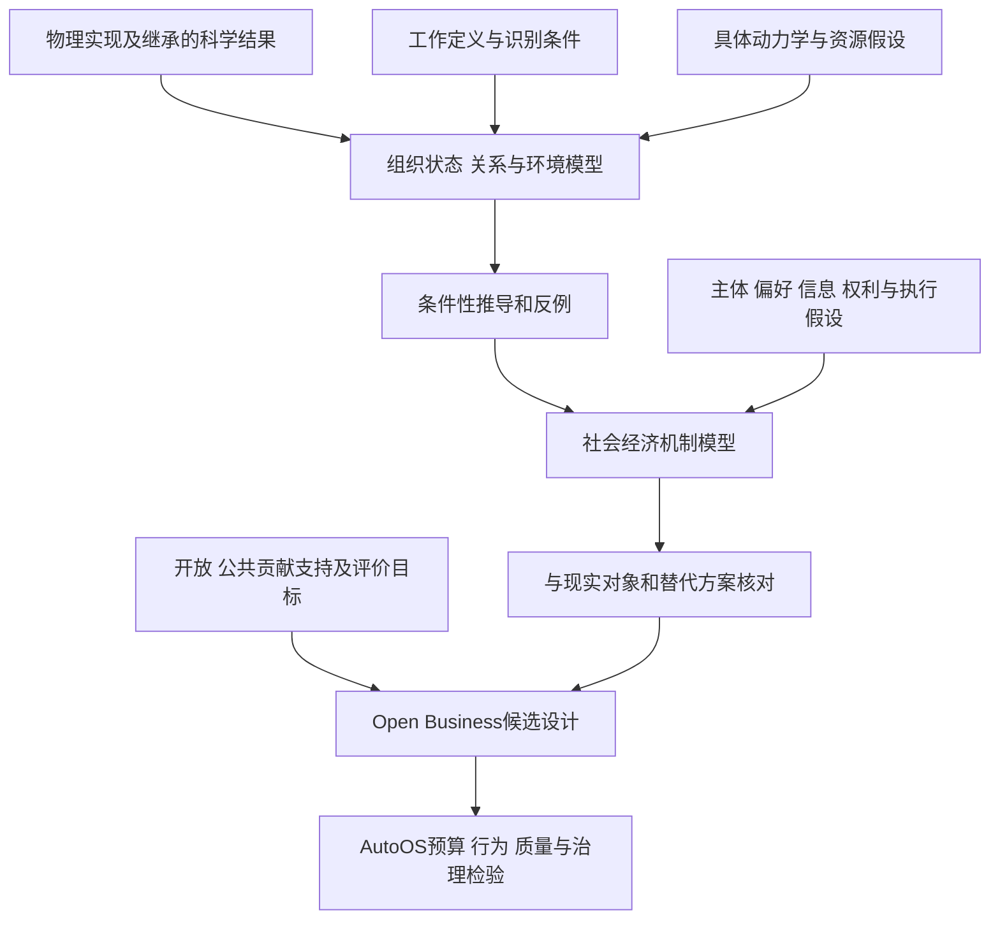

# Q1至Q8 首轮研究综合与纲领修订

日期：2026年11月12日。成果：[统一定义与命题总表](../../shared/theory-register.md)和[写作与研究纲领0.2版](../../docs/charter.md)。这是既有研究的分类与综合，本轮没有增加新的网络来源、现实试点或模型计算。各轮原文及阅读范围继续保存在 [wiki/raw](../../wiki/raw/README.md)。

## 综合判断

通用组织理论继续作为共同基础研究：研究对象由组成、关系、状态、环境与尺度描述，再分别解释持续、维护、模块、记忆与能力。经济领域增加主体选择、偏好、信息、权利及执行条件；Open Business 是这些领域机制的候选应用。

首轮已经有可复核的条件性机制和反例，可以组织连续论证。尚未形成从少数新公设唯一推出一切组织与社会定律的封闭体系。扩大通用性的下一步是检验机制映射和适用条件，而不是把现有模型的前提改名为普遍定律。

## 1 八个问题各自提供了什么

| 研究问题 | 当前可纳入共同框架的内容 | 证据类型与保留条件 | 尚未解决 |
|---|---|---|---|
| Q1 组织识别 | 相对于性质、分解、尺度和对照识别关系作用；边界与能力分别论证 | 工作定义、文献比较和中继反例；[判据](02-organization-criteria.md) | 唯一自然边界、跨案例识别的可重复性与完整形成机制 |
| Q2 自维持 | 区分结果调节、构成维护与范围限定的自维持；维护者及外部支持也需说明 | 条件性现象模型及判据；[模型](03-maintenance-model.md) | 真实维护网络、物理资源映射、启动、适应及增长的生成解释 |
| Q3 度量 | 熵、信息、复杂性与任务能力分开；严格连接保留分布、参照与物理条件 | 继承结果、有限例子；[专题](04-measures-and-bridges.md) | 通用Ordo标量、跨尺度变换与相对既有量的新增预测能力 |
| Q4 模块与层级 | 模块有不同类型；接口与粗粒化有别；收益与边界成本共同计入 | 返工和耦合的独立模型；[推导](05-modularity-models.md) | 真实模块形成、接口维护和交易边界的联合机制 |
| Q5 记忆与复用 | 记录、预测、行动与净收益分开；验证更新及共享错误进入全周期比较 | 解析模型和概率核算；[推导](06-memory-reuse-models.md) | 现实复用成本、学习过程、误检、非平稳环境及经验综述 |
| Q6 社会经济连接 | 主体、偏好、外部选择、信息与制度是新增条件；预算、参与和激励分别检验 | 三类模型、反例及文献框架；[专题](07-economic-bridge.md) | 真实动机、信息可用性、规则执行及跨期行为 |
| Q7 持续投入 | 比较自愿贡献、条件筹资、服务和赞助；回流净额、储备与到账条件共同判断 | 有限博弈、账户核算及多期数值例子；[专题](08-open-funding.md) | 同条件的现实机制比较、维护质量和长期回报证据 |
| Q8 AutoOS应用 | 区分资源与交易本金、公共回馈及运营资金；分开事后奖励与未来维护委托 | 用户历史设想、设计建议与预算反例；[应用](09-autoos-open-business.md) | 最终规则、实际费率口径、真实成本、贡献认定及试点结果 |

这些成果的层次不同，不能合计为八条新定律。既有文献中的理论和有限经验研究仍按原笔记引用，本轮没有把阅读数量转成理论可信度评分。

## 2 基本公设应当保留到什么程度

当前工作采用 **AX-01物理实现**：具体组织与行动通过物理过程实现，继承相应物理规律。它不意味着温度、熵或能量足以唯一决定所有社会变量。

“组成与关系共同描述”主要是定义及模型组织方式；“声明尺度、预算和对照”是研究要求；“某个维修变量按固定速率衰减”是特定方程的假设；“人只关心自己的收入”是可选行为假设；“公共贡献应有回报通道”是制度目标。这些都不因重要就成为同一类公设。

因此本轮没有凑成若干条普遍群体行为公设。未来可以提出少量更强的交互假设，但需要明确它们排除了哪些可能行为、在何类系统成立、如何被反驳，以及是否比已有模型增加预测。当前通用理论的研究基础仍然具体：可比较对象、因果作用、维护机制、状态与信息、资源约束及有条件的动力学。

## 3 跨层论证应如何连接

图中每次增加输入都要承担说明责任。物理规律不单独产生社会偏好；模型给出的等权总收益最优不单独产生公平结论；候选制度的目标也不单独证明执行效果。

最小的完整论证单元应包含：对象和定义、外部条件、具体机制或行动、比较结果与推导、现实映射的证据及尚未检验部分。定义选择、模型证明、经验支持和规范理由在书稿中可以相邻呈现，但须保持可辨认。

## 4 历史C01至C14如何进入新版

[首次审查](01-claim-audit.md)与两份历史对话保持原样；下表给出综合后的当前处理。“不采用普遍表述”不等于证明所有具体版本都错误。

| 旧编号 | 当前处理 | 在统一总表中的位置 |
|---|---|---|
| C01 熵缺口或KL普遍表示组织程度 | 限定为给定状态、约束与参照的量；撤去通用能力及价值等同 | DEF-08、BASE-01至BASE-03、HYP-01 |
| C02 组织必有自保本能 | 不采用；将局部维护贡献与范围限定的自维持作为子类性质 | DEF-04至DEF-06、ASS-01、PROP-02 |
| C03 自维持必然增长扩张 | 不采用从自维持直接推出增长的表述；增长需要另给投入、变化与选择机制 | DEF-05、HYP-02；当前没有增长必然性命题 |
| C04 所有秩必须持续截获负熵 | 不采用无边界的普遍版本；分开平衡结构、耗散活动、储备和实际输入 | AX-01、DEF-01、DEF-03；按具体物理模型研究 |
| C05 增长竞争必使外部熵产生最大 | 未建立，最大熵产生的普遍性尚未专题审查；不纳入公设或已证命题 | 延后研究，不能借BASE结果恢复此推论 |
| C06 层级必要且协调成本有统一规模律 | 分成模块、接口、层级、形成与成本问题；保留特定任务的收益及反例 | DEF-09至DEF-12、ASS-02至ASS-03、PROP-05至PROP-06、HYP-03 |
| C07 普遍线性折旧且破坏总更容易 | 线性损失只作ASS-01等模型假设；破坏不对称性尚未完成独立专题 | 不设通用损失率或永恒不对称定律 |
| C08 合作必然升阶 竞争只是争资源 | 不采用单一普遍定义；主体参与、规则、分配和维护需要分别解释 | DEF-14至DEF-17、ASS-07至ASS-11、HYP-05至HYP-06 |
| C09 反馈符号决定指数增长或稳定 | 不作为公设；按状态方程、增益、时延及扰动条件判定 | DEF-03至DEF-04、PROP-02及具体动力学；本轮未建立一般反馈定理 |
| C10 层级就是对称破缺并必然锁定 | 概念分开；若要连接须另给对称性、状态、变化及转换成本模型 | DEF-12、Q5未来成本比较；没有通用等价式 |
| C11 高秩必有自组织临界和雪崩 | 尚未完成专题研究，不把复杂性、脆弱性和临界性等同 | 延后研究，不借一般组织框架默认成立 |
| C12 超过阈值必产生内部预测模型 | 未推导；已有预测收益模型不解释预测器如何形成 | DEF-13、ASS-04至ASS-05；形成问题另立假说 |
| C13 记忆构成单调不可逆棘轮 | 不采用无条件版本；保留过时、错误、更新及可选策略 | PROP-04、PROP-07至PROP-10、HYP-04 |
| C14 Ordo自然能量单位及通用增益减线性损失方程 | 不采用自然单位及通用方程；单位约定不能替代物理解释，特定动力学另给假设 | BASE-03至BASE-04、ASS-01、HYP-01 |

数值反例说明某种强推论不由已有共同前提单独得到，并不自动证明现实中的相反普遍命题。最大熵产生、临界性、增长起源等未做完的问题应继续明确标记，而非悄悄删成已经解决。

## 5 从0.1版到0.2版的主要变化

原[纲领0.1副本](../../docs/history/charter-v0.1-2026-11-11.md)逐字节保存，校验信息另存；当前纲领在原位置更新。

| 位置 | 修订后的处理 |
|---|---|
| 项目定位 | 保留跨物理、生命与社会的通用研究目标，明确书籍、论文与AutoOS应用的不同成果责任 |
| 基本主张 | 从宽泛主张进一步分成工作定义、继承基础、公设地位、领域假设、条件命题、待验证假说、目标与参数 |
| 层级封装和信息杠杆 | 保留为主要机制研究线索，明确形成、收益、维护、共同失效及成本边界，不称必然阶段或普遍倍增系数 |
| 从物理到社会的连接 | 明确主体、偏好、信息、权利和执行条件的输入，避免把定义或制度愿望藏进物理推导 |
| 开放商业 | 根据Q8具体区分资金用途、贡献回报与维护委托，费率等继续为候选参数 |
| 研究与起草顺序 | 反映首轮已有模型的实际进度，不再把建最小模型排在远期；下一步分别推进证据补齐与章节论证卡 |
| 完成标准 | 以命题可追溯、条件明确、能提出失败情形及实际检验为依据，不以叙述完整表示理论已成立 |

本轮采用工作定义，并没有修改历史论文原文、旧对话或各模型参数；也没有起草书籍正文、设置实际收费或进行试点。

## 6 下一阶段怎样并行推进

| 工作方向 | 下一项成果 | 进入后续阶段的条件 |
|---|---|---|
| 物理与复杂系统综述 | 把首轮定向阅读整理为明确的检索、纳入与证据地图，补齐所声明范围 | 能区分既有结果、争议、采用条件和未读线索，不把首轮当完整系统综述 |
| 通用机制研究 | 选择维护、模块或复用中的一个机制，补真实对象映射、现实参数或更强的解析条件 | 说明模型相对既有工作的贡献，给出可复核方法及失效条件 |
| 社会经济连接 | 对同一维护任务比较参与、激励、净额和跨期承诺，补现实成本与质量证据 | 不把融资与购买的分别核算当联合行为均衡，不把活动量当维护质量 |
| AutoOS应用 | 完成规则口径和实际角色资料，收集成本、退款、回馈及维护任务数据 | 再检验HYP-08至HYP-10，不用示例参数填成经营事实 |
| 书籍路线 | 依据统一编号建立基础、经济连接与公共回馈三张论证卡 | 每张卡列出可讲结论、依赖假设、反例与缺口；样章可以表达有限结论，不预定全部理论成功 |

通用理论可以继续从底层深化，书籍也可以基于已厘清的问题推进。两者共享同一总表，分别按研究证据和读者解释的标准更新。
