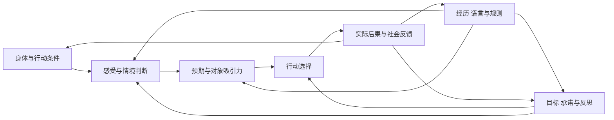

# 维持条件怎样进入感受 欲望与目标

日期：2026年11月12日。状态：承接[人的维护对象与条件](13-human-maintenance-objects.md)的机制讨论。采用三份新增PDF、一份原始PDF未取得的网络工具读取副本，并复用L55等既有材料。实际范围见[阅读记录](14-reading-notes.md)，来源保存在[wiki/raw](../../wiki/raw/round-13/README.md)。

## 本轮核心判断

客观维持条件不会自动变成人对自身需要的准确理解。研究需要分别解释：身体和环境的哪些变化可被感知，经验如何影响判断，哪些对象取得吸引力，行动如何受到目标和条件约束，结果怎样改变后续学习。

人的感受、欲望、认可的目标与实际后果需要分别测量。这些过程可以相互支持，也可能失配。对失配的解释不能预先假定所有行为都在最大化同一个生存量、愉快量或Ordo。

## 从维持条件进入行动的工作框架

下图表示待研究的机制联系与反馈，不是已经完成的演绎链，也不要求每次行动按同一顺序经过所有环节。

客观条件既约束身体过程，也影响可行行动。人可以通过感受、观察他人、语言说明、工具与长期经验认识这些条件；有些调节不要求形成明确的语言判断。未来预期和社会评价也可以参与行动，不必等到眼前出现生理缺失。具体的探索和发展动机仍需机制研究。

形成问题还应分成不同时间尺度：生物演化与发育怎样形成调节和学习能力；个人经验与社会互动怎样改变对象评价和目标；当前状态与情境怎样改变注意和行动。这些过程不能被一次条件学习实验共同解释。本轮主要定位后两类机制，尚未完成它们与生物演化的整体连接。

评价对象也可以涉及他人的处境和共同任务。本框架不预先要求每个目标都只关心自己的即时收益；后续需要比较助人、共同承诺和个人利益怎样进入具体目标，不能把一切助人行为事后解释成隐蔽的自利。

## 感受不是对客观需要的完整说明

可以把“感受到了什么”“怎样解释它”“对解释多有信心”分别研究。Garfinkel等提出对内感受的任务表现、主观自评和信心与表现的对应作区分，本轮采用其概念框架，不把一种心跳任务推广为人认识全部需要的能力。[原论文](https://doi.org/10.1016/j.biopsycho.2014.11.004)。

Desmedt等进一步表明，心跳计数任务可能混合真实感知、心率估计和报告阈值等过程。其修改指令后得分变化，提醒我们核查测量，而不是直接宣布参与者对身体的了解改变了同等比例。该研究也不能推出所有身体感受或自我报告都不可靠。[原论文](https://doi.org/10.1016/j.biopsycho.2018.09.004)。

本项目据此保留两件不同的事：感受作为体验本身是研究对象；对它的原因、相关需要及应对办法的判断，需要证据。后一项可能有多种解释，不能用一个观察标签唯一确定。

## 想要 愉快与认可分别处理

| 研究对象 | 需要观察什么 | 不应直接替代什么 |
|---|---|---|
| 趋近或取得某物的倾向 | 注意、选择、愿付努力及相应自我报告 | 获得时的愉快、长期利益或认可 |
| 活动或结果带来的愉快 | 相应体验与特定实验指标 | 更强的追求动机或持续受益 |
| 当前操作目标 | 行动在当时试图实现什么局部结果 | 对这一目标的全面反思或道德认可 |
| 认可的目标与承诺 | 人怎样理解价值、是否愿意维持或修改承诺 | 实际必然做到，或目标必然正当 |
| 实际行动及后果 | 当时可行什么、做了什么、产生什么变化 | 由行为唯一反推完整动机 |

Berridge与Robinson区分奖励的愉快与狭义激励显著性相关的wanting，并且区分这种线索引起的动力与日常认知性欲求。本项目采用其“不同过程须分别识别”的启发，不把全部欲望归因于单一神经递质，也不把日常行为用临床理论一概归类。[原论文](https://doi.org/10.1037/amp0000059)。

L55则提供另一层区分：在其自我决定理论中，行为可受到外部奖惩、内在压力或不同程度的认同与整合影响。人在心里给自己施加压力，不自动等于已经认可任务的价值；完整内化也不必把工具性活动变成因活动本身有趣而行动。这些是需与其他理论比较的领域解释。[原论文](https://doi.org/10.1207/S15327965PLI1104_01)。

因此，同一项持续行为可能对应不同的动力和理解；一个人也可能认可某个目标，却遇到能力、机会或其他动力的约束。认可程度、可行性与实际履行分别检验。

## 经验怎样使某个对象变得重要

Schultz、Dayan与Montague把特定条件学习中的奖励相关神经响应与预测误差联系起来。在给定的模型里，学习关注实际反馈与预期的差别，以及当前线索怎样预测后续奖励。论文也指出，标量误差信号不足以独自描述复杂环境中的奖励类型与注意。[原论文](https://doi.org/10.1126/science.275.5306.1593)。

这一机制给我们一个有限的研究入口：一个对象的当前价值，可能与它曾预示什么、带来什么、现在处于什么情境有关。将这个思路扩展到分数、金钱、地位、认可或共同承诺，需要分别研究人与制度之间的具体学习过程。不能从动物条件学习直接推出完整的社会偏好形成史。

本项目的关键连接问题由此变得更清楚：可感知的反馈，何时准确反映某项能力的维护和发展，何时只反映一个局部指标？预测得越来越准，是否也在追踪真正关心的结果？“学会预期反馈”与“反馈对应值得实现的结果”是两件事。

奖励信号、预测误差、统计信息与热力学熵分别定义。即使使用相似的数学工具，也不能省略奖励如何生成、与身体或社会条件如何对应的机制。

## 一个学习者的假设例子

设想一个人希望掌握一项技能，环境却主要对某种短期表现给分。如果取得分数的方法与完成真实任务的方法逐渐分离，他可能越来越熟练地取得高分，却没有相应提高真实任务能力。

这个例子中，应分别观察：他是否理解评分规则；分数是否具有实际机会价值；取得分数是否带来愉快；他认可的目标是技能、分数还是另一个结果；时间和资源是否允许选择其他路径；真实任务能力究竟怎样变化。

这不是对某个现实教育或平台机制的效果判断。它说明，发现指标与能力失配之后，还不能直接断定参与者愚蠢、不诚实或缺乏自制。他可能在准确回应实际制度，也可能误解结果或受其他动力影响。具体解释必须接受比较。

反过来，某种反馈也可能帮助人理解行动与后果，支持形成更可靠的长期目标。是否如此，需要同时测量反馈、理解、能力变化与实际选择，不能只数奖励发放了多少。

## 两个可以明确论证的有限关系

### 单个感受未必能唯一识别需要

设模型中的两个状态x₁、x₂具有相同可观察信号g(x₁)=g(x₂)，但对一项已声明任务的所需支持N(x₁)≠N(x₂)。仅使用该信号的确定性判断h(g(x))，不可能在两个状态上都准确给出N，因为相同输入只能给出相同输出。

这是条件性的识别论证，不是证明现实中所有感受都模糊。增加观察、背景知识和时间信息，可能区分这两个状态；判断是否可区分需要经验研究。也不能把它当作否定当事人感受或替其决定生活的理由。

### 反馈评价与能力后果可以排序不同

若在一个给定模型中，两种可行行动a、b满足反馈评价R(a)>R(b)，而实际任务能力后果K(a)<K(b)，则最大化R不会在这两个选项中选择K更高的行动。此处成本、未来影响及环境按比较需要纳入R和K，不能隐藏有利条件。

这个逻辑关系尚未说明现实人一定最大化R，亦未证明现实中的某种评分必然与能力相反。它明确了经验研究必须检验的桥梁：反馈怎样影响行动，其排序与声明的真实结果怎样对应。K如何定义以及为何重视它也需说明，不得把K默认叫作善或Ordo。

## 与通用组织理论的连接

现阶段可以研究一个具备维护约束、有限观察、学习和多种行动倾向的组织。它通过具体机制使用反馈，形成对环境和自身的判断，再影响可行行动与未来条件。这是一项候选组织模型；哪些机制在人类中实际存在、怎样组合，必须分别验证。

从物理约束到动机之间，还缺少可测的映射。若把任何奖励都叫作“秩增加的信号”，却不允许奖励与能力失配，理论将失去解释误判和冲突的空间。更有价值的问题是：反馈在什么条件下支持持续能力，失配怎样出现、被发现和修正？

社会规则可以参与这个过程：它们分配机会、组织反馈、解释何者被赞许，也提供争论与改变目标的方式。规则的形成、个人内化和伦理正当性仍然分开。这使下一步的人际互动与规范研究能够接上人的具体形成过程。

## 本轮候选分类

| 陈述 | 地位 | 后续责任 |
|---|---|---|
| 维持条件、感受解释、追求倾向、愉快、目标和后果分开 | 工作分析约定 | 操作化并比较相邻概念，不以分组本身证明机制 |
| 感知包含不完全观察及具体判断过程 | 领域或模型假设 | 说明观察通道、噪声、背景信念与测量方法 |
| 同信号对应不同所需支持时，单信号不能完美识别二者 | 已明确的条件性逻辑论证 | 现实是否满足前提另查，不作全人类错误率定律 |
| 反馈评价与能力排序不同，优化前者不保证后者 | 已明确的条件性逻辑论证 | 检验具体R、K及实际选择规则；不是新经验结果 |
| 目标认可、奖励学习和行动倾向可以出现失配 | 机制研究方向，部分文献提供限定支持 | 对应任务、群体、方法与替代解释，不预设唯一模型 |
| 改善反馈与能力的对应会改善持续合作 | 待验证的进一步假说 | 还需参与成本、关系、承诺和制度执行条件 |
| 人始终最大化统一Ordo或所有欲望都准确表达需要 | 尚未确立的强主张 | 不进入基本公设，须提供独立定义与预测 |

这些候选条目未改变79条正式总表的编号。本轮也不以“受到自己认可”定义一个目标在伦理上正确。

## 下一步研究怎样推进

可先限定一类学习或协作任务，保持任务资源与报酬条件可比较，改变反馈是否准确反映真实任务表现。独立记录实际能力、反馈理解、追求倾向、愉快、目标认可与后续选择，观察这些量是否一起变化。

如要作因果比较，应明确分配方式、任务难度、先前能力、时间与报酬，以及反馈的情绪强度等竞争解释。本轮只提出研究问题，没有招募被试、收集生理信号或执行实验。后续习惯、情绪分类、长期目标冲突和较新奖励研究仍需补充。

书籍可将这轮内容作为“维持条件怎样进入需要与目标”的候选材料；现有开篇讨论稿保持，待讨论后再扩展。下一步最值得追问的是：人在多种欲望、他人期待与长期承诺之间，怎样形成暂时的优先顺序，并学会修正自己的目标？

## 后续讨论

上述追问已继续形成[目标冲突中的优先顺序与目标修订](15-goal-conflict-and-revision.md)，区分可行性、执行安排、目标评价及共同承诺，见[新增阅读记录](15-reading-notes.md)。
