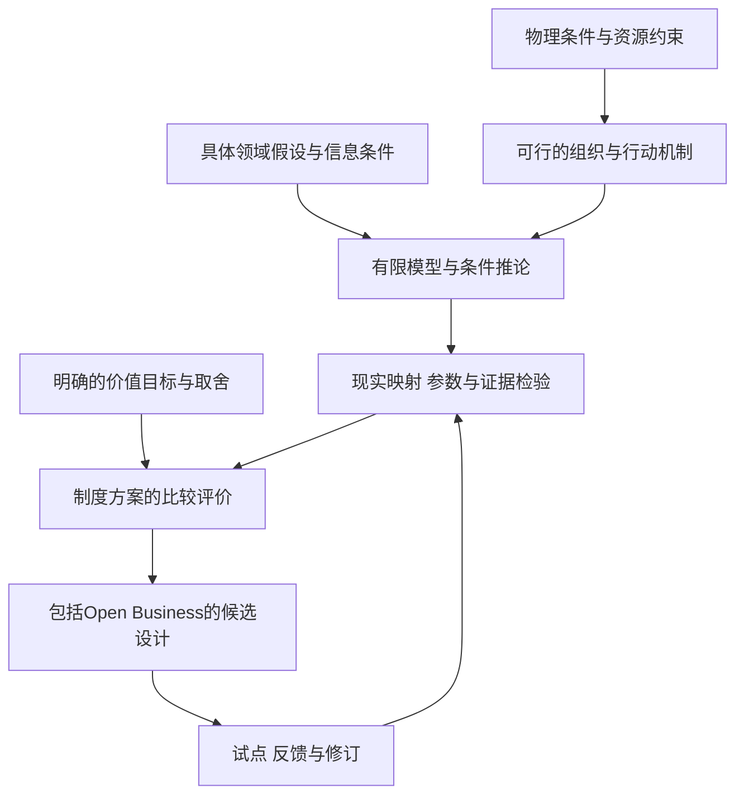

# 全书框架 论证缺口与研究优先顺序

日期：2026年11月12日。性质：对[六部分目录与八章讨论稿](../../book/README.md)、[纲领0.3](../../docs/charter.md)、Q1–Q8研究及人类路线的整体审查。新增AI与机器人背景资料见[阅读记录](18-reading-notes.md)及[第十八批归档](../../wiki/raw/round-18/README.md)。本轮不修改正式79条总表，不将结构建议自动写成新章或既定结论。

总体判断：六部分可以作为下一阶段稳定的工作骨架，尚不构成完整的理论证明。局部条件推论与多数跨层连接的区分方向正确，社会组织、经济制度与AI背景的证据和模型明显弱于人的讨论。现有成果支持提出和检验Open Business，尚不能证明它是不可替代的制度。

同日用户进一步指出，更上游的缺口是经济学基础尚未系统导入，即财富怎样涌现。该定位已形成[财富形成的研究连接](19-wealth-emergence-and-economic-foundations.md)：先解释可用成果、能力、积累与维护，再研究计价、权利与分配，且保留制度对生产的反馈。以下原缺口继续有效，但不再将产权与分配视为经济连接的最早起点。

## 结构已经稳定到什么程度

| 层次 | 当前判断 | 下一步应稳定什么 |
|---|---|---|
| 六部分的问题顺序 | 可以作为工作骨架 | 保持通用基础 人 互动 组织比较 经济 应用的连接 |
| 第二 第三部分八章 | 已有连续讨论稿及论证卡 | 审阅篇幅与跨层连接，补竞争解释，避免哲学内容压过经济论证 |
| 第一部分 | 已有Q1–Q5有限研究，正文未成稿 | 正式综述与少量能反复使用的机制，而非物理术语总览 |
| 第四部分 | 有对象清单，尚缺系统比较 | 成员 资源 权力 退出 维护和外部影响的共同维度及具体案例 |
| 第五 第六部分 | 有Q6–Q8机制及账户核算，未完成行为与现实验证 | 产权 资本 分配 比较机制及AutoOS真实数据 |
| 通用新理论 | 仍为研究目标 | 新量或新机制相对既有知识增加了什么可区分预测 |

可以暂时停止大幅移动六部分，集中补论证。当前八章集中在人与规范，其余四部分仍待写作，不能以已有章节数量判断全书已接近完成。建议增加一个经济问题导向的引言，让读者先理解AI、机器人与共同成果维护为何成为问题，再进入通用基础。引言不应先宣称劳动已经消失或开放商业已被证明。

人的意义保留为价值反思的连接，不成为每个经济命题必须先解决的形而上学前提。理论上的依赖顺序与面向读者的叙述顺序，可以不同。

## 目前缺少的关键连接

### 形成和改变组织的具体机制

维护一个给定组织，与解释它如何从较松散的互动形成，不是同一问题。伙伴选择、分工形成、承诺稳定、进入退出、冲突与创新，都需要具体机制及历史或实验依据。不能只写形成后维护有效，就倒推该组织必然出现。

第四部分宜选择少量差异明显的情境，而不是把全部组织名称逐一罗列。例如比较共同维护一项知识成果、家庭照料、雇佣型企业和公共服务的成员条件、选择机会与责任。成员不能自主退出的情境，不能直接套用独立成人的自愿交易模型。

### 从共同能力进入经济分配

共享降低某些重复投入，并没有决定谁拥有资产、谁承担风险、价格怎样形成、谁取得剩余或谁有治理权限。至少需补产权与使用权、资本与投资、交易和定价、需求与分配、公共支持及跨期风险的连接。

不必把本书写成全部经济学的百科，但应说明微观合作怎样进入市场、产业和总体生活条件。个别主体可行的账户安排，不能单独证明全社会需求、就业或分配结果。

### 基本保障与贡献回报的区别

如果本书提出基本尊严不以贡献为条件，那么为贡献者提供回报，只回答一部分问题。未能被识别、暂时不能贡献或不参与平台的人，怎样取得基本支持，不能由贡献评分自动解决。

Open Business可以承担某些经营与公共成果维护功能，也可能需要与家庭照料、公共服务、社会保障或其他安排互补。具体组合仍需论证，不能把一个回馈池定义成全部生活保障。

### AI与实体机器人的不同约束

AI生成内容与复制软件，和制造、部署及维护机器人，不能共用一个无差别成本模型。实体资产至少涉及融资、设备和能源、使用寿命、维护停机、运行责任及收益权。知识来源与贡献识别也不等于拥有机器人资产的份额。

现有AutoOS的研究场景主要是内容保留、传播、交易与回馈。若将其扩展为机器人时代的组织模式，需要说明机器人属于谁、服务卖给谁、经营净额怎样形成、谁有权改变规则，以及无法参与者怎样得到支持。现有示例费率与公共回馈机制未回答这些问题。

## 整体推导逻辑应怎样理解

更准确的结构是有分支的论证，而不是从一个物理量一直演绎到唯一商业模式：

现有书稿把物理约束、模型条件、经验结果、意义解释和价值主张分开，是正确的修订方向。仍需特别检查四种跳跃：有能力不等于会形成；共同收益不等于愿意参与；个人认可或组织稳定不等于正当；一套方案可运行不等于所有替代方案都不可行。

许多已写关系是教学用的逻辑结果或账户恒等式。它们可以排除错误论证，却不自动构成本项目的新理论贡献。论文需要指出相对已有研究新增了什么定义、机制、识别方法或可检验预测。

## 能否推导出Open Business的必要性

| 必要性的含义 | 当前可支持到哪一步 |
|---|---|
| 一切复杂组织都必须采用Open Business | 不支持；组织定义及既有反例不要求共同目标，更未排除其他制度 |
| 现代社会只有这一种可行经济制度 | 不支持；没有完成替代方案与宏观结果比较 |
| 在特定问题和价值目标下需要某些功能 | 可以作为条件性论证目标，例如持续维护需要资源与责任安排 |
| Open Business在某类条件下更合适 | 可以检验，需要同任务 同质量 同期限的净成本 参与 履约与分配比较 |
| AutoOS应选择某个具体版本 | 需要实际能力、成本、规则和试点数据，不能仅凭理论愿景确定 |

设背景条件为C、明确目标为G、实现目标不可缺少的功能为R。即使证明C与G共同要求R，也尚未证明只有某个制度D能够实现R。将所需功能直接命名为Open Business，再宣布其必要，会把定义当作证明。

更有价值的目标是建立：在可复用成果收益分散、持续维护成本真实存在、参与者具有实际选择且希望回报和责任可核对的条件下，需要怎样的投入回流与治理功能；再比较哪些Open Business设计及其他安排能有效实现这些功能。

应保留直接赞助、明确维护采购、成员或合作社安排、公共服务及传统服务经营等替代或组合。它们是比较对象，不在本轮宣称已经证明成败。某种替代安排在明确条件下也能实现目标，就足以否定唯一实现路径的主张，但不否定Open Business本身的价值。

## AI与机器人使哪些问题更紧迫

本轮补查的原始来源支持重新研究任务与收益分配，不能支持技术会自动选出一种制度：

- L79 Acemoglu与Restrepo的任务模型区分生产率、替代和新任务的恢复作用。所设条件下，生产率提高与劳动所得的变化可能不同；不是对2026年全部AI效果的预测。
- L80 ILO官方2025年研究介绍讨论职业任务暴露。潜在暴露不等于已采用，更不等于实际岗位已经消失；本地原PDF未取得，没有据其完整方法给出进一步预测。
- L81 Brynjolfsson等2025年期刊论文研究一个企业、一个职业中的AI辅助，显示收益存在差异。主要分阶段上线研究不能笼统称为全样本随机试验，也不推出全社会就业净效应。
- L82 IFR于2026年9月24日公布2025年工业机器人数据。本轮仅用于确认具体部署背景；工业机器人不是通用人形机器人，安装量不能直接换算替代人数，未来安装预测也不当作事实。

出处、范围与获取状态见[阅读记录](18-reading-notes.md)。四项补充只是本轮背景校准，不是AI经济或机器人研究的充分综述。

应比较至少三类情景：AI主要增强现有人类任务；自动化明显替代部分任务但新任务和制度同时调整；高自动化持续压低部分人通过劳动取得收入的机会。分别观察资产控制、真实稀缺、需求、收益权及公共支持，不能只设置一条必然通向大规模失业的未来。

AI可能降低部分生成、搜索和协调成本，也可能增加验证、资产控制或集中依赖问题；前者不单独证明开放必胜，后者也不单独证明封闭必胜。哪些变化支持具体开放安排，需要独立研究。

## 背景研究是否足够

| 目标 | 判断 |
|---|---|
| 确定问题地图和形成讨论稿 | 已有足够先导基础 |
| 形成跨学科概念比较的起点 | 可以开始，仍需固定检索和纳入规则 |
| 宣称已经完成系统或范围综述 | 尚不满足：既有轮次多为问题驱动定向阅读，覆盖和排除没有统一记录 |
| 提出完整通用组织新理论 | 尚不足：Ordo操作化、起源机制、跨层映射及新增预测未完成 |
| 判断AI经济与Open Business相对优势 | 尚不足：产权 资本 分配 政治经济和替代制度证据明显欠缺 |
| 验证AutoOS制度可持续及有效 | 尚不足：真实预算、履约、质量、选择和长期维护数据缺失 |

文献编号包含未取得正文的线索，原文下载也不等于完整阅读；数量不能替代范围覆盖、方法质量或现实验证。

## 论文侧可以立即开始什么

建议把原先宽泛的物理学与复杂系统总题目，作为系列地图；首篇缩小为“组织的持续与自维持：非平衡物理、控制与生命组织理论的概念和机制比较”。形式为范围综述加概念机制比较，不预设必须建立统一标量或得出Open Business。

本轮已准备[首篇检索与纳入协议草案](../surveys/01-organization-maintenance/protocol.md)。这是可启动的研究安排，不是已完成数据库检索、预注册或文献筛选。既有L01–L14等材料作为种子，不能自动全部纳入；正式检索仍需寻找不支持当前框架的材料。

书籍侧同时补AI时代的产权、资本、回报、保障与治理专题，为第四至第六部分建立比较矩阵。两条路线共享概念，不要求物理综述承担商业模式的证明责任。

下一步最具体的成果应是首篇survey的预检索记录、首轮纳入与排除清单、概念机制矩阵及一组待解决的定义冲突；书籍侧先形成AI与机器人背景下的制度问题矩阵和Open Business比较命题。暂时不宜继续大批扩写正文或把商业必要性写成结论。
