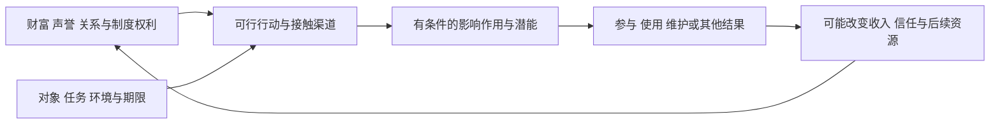

# 影响力与社会资源换算研究

日期：2026年11月12日。首轮问题导向survey。结论是：**这条路线值得深入，尤其适合连接组织能力、人际关系与非货币协调；影响力能否进一步成为跨领域共同尺度，应作为独立的度量与验证问题。** 当前资料支持有条件的影响度量和资源转换研究，尚未建立影响力、财富、权力与名声的通用换算体系，也没有从热力学推导出它们的自然等价关系。

同日用户进一步明确影响力指“可以调动他人产生新行为的能力”。研究核心现据此收窄为[目标导向的行动动员](mobilization-definition.md)，优先比较目标、他人响应、动员资源与时间；信息容量保留为辅助候选。补充[累积优势与增长形式的演算](mobilization-models.md)及[来源说明](mobilization-reading-notes.md)，下文首轮概念地图保留作背景，不将知名度或一般预测信息当成用户定义。

进一步沿用户提出的传播技术—影响力—生产力—秩开展[信息协调专题](communication-productivity-and-order.md)。比较知识获取、传递、核验和执行；保留物理联系的条件，以任务有效的协调能力作为候选维度，并核算可行集合、注意力瓶颈和任务信息例子。[第二十七批](../../../wiki/raw/round-27/README.md)保存采用材料及稿本区别。

本轮回应用户新提出的“隐藏线路”。旧AI对话中的影响边界及写作影响，不自动成为本轮社会影响指标的定义或证明。项目现有HYP-01保留Ordo统一指标的开放问题，见[正式总表](../../../shared/theory-register.md)及[Q3度量比较](../../reviews/04-measures-and-bridges.md)。本轮不更改79条基线或纲领0.3。

配套：[数学候选与有限演算](models.md)、[桥接与验证路线](research-program.md)、[来源及实际阅读](reading-notes.md)、[检索范围](search-and-selection.md)、[原始资料](../../../wiki/raw/round-25/README.md)。

最新补充[文学艺术、体育与未来行动的形成](art-sport-and-cultural-influence.md)：研究体验、记忆、认同、信念与价值判断如何进入未来选择，再连接社会组织变化。“感动人的能力”保留为美学提案，体验意义、影响强度与伦理后果分别讨论；[实际来源与体育复核争议](cultural-reading-notes.md)及[第二十九批](../../../wiki/raw/round-29/README.md)记录范围。

随后研究[领导、共同方向与纠错](leadership-coordination-and-correction.md)：领导可以降低任务中的协调损耗，方向一致、判断可靠性、分工和适应分别评价；自由选择不必正态分布，错误统一也未必优于保留差异。[有限例子](leadership-models.md)与[第三十批](../../../wiki/raw/round-30/README.md)记录条件，不将磁化比喻升为通用Ordo公设。

进一步另立[企业领导、传播与公司治理专题](../05-firm-authority-and-democracy/README.md)：将经济领导和广告独立研究，深化一致性与适应的机制，并把公司权力、成员参与和AI时代的组织比较纳入第四、第五部分；不把企业的产权或授权结构当作所有群体的定义。

## 这条主张有三个不同层次

| 层次 | 要说明什么 | 本轮判断 |
|---|---|---|
| 共同解释框架 | 财富、声望、关系和职位怎样改变主体影响结果的能力 | 研究价值高，已有直接相关传统；需补具体机制及不同资源的独立作用 |
| 有边界的共同度量 | 在明确对象、任务、期限、成本与基线下比较影响，并估计资源之间的转换 | 可开展模型和经验研究；单位、误差及转换函数需要固定 |
| 跨领域统一等价尺度 | 将不同任务及资源纳入同一有意义的数值，支持所要求的比较、加总或换算 | 尚未确立；必须分别论证这些运算，不能以能计算一个分数代替 |

统一尺度不必意味着任何时候都采用固定汇率：货币计价也容许价格变化。反过来，承认转换函数随制度和情境改变，尚不能证明存在一个不依赖这些条件的内在影响力总量。首先要明确希望保留的是排序、差值、比例、加总，还是实际交易中的替代关系。

## 影响力需要与哪些概念区分

| 概念 | 工作识别方式 | 与影响力的关系及边界 |
|---|---|---|
| 影响作用 | 某行动相对于明确替代行动，使他人行为或共同结果怎样改变 | 是关系及任务中的差异，不只是某人有多少追随者 |
| 影响潜能 | 在可行行动、成本和期限内，能够造成哪些改变 | 未使用的能力与已实现效果分开；不能任意设无限资源 |
| 注意力和知名度 | 被看见、记住、讨论的程度 | 提供接触机会，可能伴随信任，也可能伴随厌恶或抵抗 |
| 声誉和信任 | 特定群体对能力、可靠性或规范表现的判断 | 可能降低协作和核验成本；不同群体、任务及正负评价分别记录 |
| 网络位置 | 关系数量、桥接、路径及中心性等结构性质 | 是传播或资源可达性的模型指标，不自动等于因果影响 |
| 权力和权威 | 决定、阻止、授权及执行某些行动的能力与制度位置 | 可能通过规则和资源发挥作用；合法性、实际执行及服从需要另辨 |
| 财富与货币资源 | 特定核算边界的资产、索取权或可动用支付能力 | 可以购买服务及扩大行动机会，但不是所有影响的充分条件 |

这些是本项目的工作区分，并非声称社会科学已有唯一术语体系。善意说服、知识帮助、共同协商、误导和胁迫，都可能改变行为；是否造成改变与是否值得赞同，是两个问题。

## 已有研究与本路线的相邻位置

**关系性的权力。** Dahl1957要求说明谁影响谁、依靠什么资源、采用什么手段、涉及什么反应。他提出概率化的表达，同时明确把形式概念与具体操作化分开。这支持从“某人有多少权力”进入有范围的关系分析；本轮候选采用现代干预记法，不将它反填为作者已经解决的因果识别方法。[L138原文](https://fbaum.unc.edu/teaching/articles/Dahl_Power_1957.pdf)。

**不同资本及其转换。** Bourdieu讨论经济、文化、社会资本及象征作用，强调关系的积累、动员、承认和转换成本。他也作出更强的论述，把广义劳动时间称为普遍等价物，并类比能量守恒。因此不能把他的立场改写为“否定一切统一尺度”，也不能说他已经证明了影响力是普遍等价物。本轮借鉴其问题结构，把普遍劳动时间和社会能量守恒另视为需要独立检验的理论主张。[L140英文教学排版](https://web.stanford.edu/~eckert/Courses/ParisPapers/Bourdieu1986.pdf)。

**网络指标。** Katz1953按关系链及衰减构造地位指数，明确同一群体对不同内容可能有不同反应，连边是否存在、是否有效及衰减条件都须说明。它提供可计算的网络描述，并不把认可、传播和收入证明为同一量。[L141原文](https://www.cs.cornell.edu/courses/cs6241/2019sp/readings/Katz-1953-status.pdf)。Watts与Dodds2007的模拟则提示，大传播的出现还取决于接受者和网络条件，不宜只从成功传播倒推某个发起者拥有恒定的巨大影响。[L143原文](https://pdodds.w3.uvm.edu/research/papers/others/2007/watts2007a.pdf)。

**因果识别。** Shalizi与Thomas说明，观察到朋友行为相似，可能来自潜在相似性、结交选择与共同因素，而不只是传播；这不是说所有影响都不可识别。[L144实际2010年草稿](https://www.stat.cmu.edu/~brian/780/bibliography/01%20homophily%20and%20contagion/shalizi-thomas-homophily-contagion-2011-SMR.pdf)。Bond等2012年的随机处理研究提供了特定社交提示影响行为的经验入口，但其自我表达、信息寻找和经记录验证的投票是不同结果，不能合成通用影响力分。[L145期刊稿](https://sparq.stanford.edu/sites/g/files/sbiybj19021/files/media/file/bond_et_al._2012_-_a_61-million-person_experiment_in_social_influence_political_mobilization.pdf)。

**理论定位线索。** Parsons1963的官方摘要提出广义影响概念，Coleman1972摘要以主体、事件、控制及利益构造交换框架。它们与用户提案直接相关，但本轮未取得正文，故不以摘要证明具体交换模型或“通用媒介”命题。原文阅读是明确的后续任务，见[来源记录](reading-notes.md)。

## 最接近熵秩桥接的候选

Schreiber的转移熵量化：给定目标自身历史，另一过程的历史为预测其下一状态增加多少信息。它具有方向性，但仍须处理共同驱动与观测范围；原文在生理例中也保留共同外因的解释。本项目的共同原因例子得到转移熵1bit而干预效果为0，说明未经识别不能直接把该数值叫作社会支配能力。[L146实际arXiv稿](https://arxiv.org/pdf/nlin/0001042)。

**Empowerment是更接近用户设想的明确候选。** Klyubin、Polani与Nehaniv2005把行动到未来自身感知的通道容量作为可感知控制能力，单位为bit；开头也把金钱、社会地位与更多可选行动联系起来。它提供了从主体—环境耦合进入能力度量的数学形式。[L147大学原件](https://uhra.herts.ac.uk/id/eprint/282/1/901241.pdf)。

但这里的“可区分后果有多少”，不等于这些后果有多符合目标、对别人有益或能换多少收入。原文还讨论了能在黑暗中制造闪光的能力，即使不具有通常意义的用途，也可能被该指标保留。把自身感知换成其他人的行动，是本项目可以研究的扩展，需要声明变量和识别条件，不能称原文已完成这一社会桥接。

所以，应分开三步：用信息论描述已定义的行动通道；检验它能否解释特定任务中的实际影响；再检验资源及收益怎样与该影响相连。bit这一共同单位本身，不证明它与热力学熵、Ordo、财富或社会价值存在固定换算。

## 影响力能怎样成为中间分析尺度

可以先围绕共同结果建立桥梁。例如，一项免费知识服务想获得合格审核、稳定维护及真实使用，价格为零并不能完整描述谁帮助这些行动发生。影响力可以描述某项推荐、组织安排或资源投入，使这些结果增加多少；货币仍用于核算实际支出与可支付余额。

这张图是待检验的机制框架，不断言所有资源的作用都必须经过同一个中介，也不假定循环中存在守恒量。若把“影响”定义为任何最终后果，图会变成重述；因此要保留独立可观察的行动、结果与竞争解释。

在同一任务下，可以估计资金、声誉、关系与授权分别怎样改变结果，进而讨论局部替代。但“同样多的预期审核参与”不等于审核质量相同，更不意味着声誉可以像货币一样转让。资源价格、效果等价、补偿要求与法律/规范允许的交易是不同问题。

## 哪些统一要求需要分别检验

首先是跨任务排序：若A善于组织技术维护，B善于另一类动员，同一正向标量未必能同时保持两种排序。这个反例只限制要求保持所有任务排序的版本，不否定明确权重后的综合分或限定领域的共同单位。

其次是可加性：多个人影响同一事件会有重叠、互补和替代；传播回路还可能重复计数。最后是谁触发事件、总结果改变多少、怎样分配贡献，是不同问题，需连接[上一轮共同作用演算](../03-competition-cooperation-distribution/contribution-models.md)。

还要检验跨群体的测量是否相同、潜能与已用能力是否混淆、能否转让、转换损失、时间及收益风险。把这些条件写进模型是进步；不能把它们当作测量误差而删去。

## 对价格尺度的判断

影响力可能更适合分析零价格成果、动员、可信关系和制度控制；价格更直接服务实际交易、预算和机会成本的核算。哪种更容易分析，应以具体问题中的解释与预测改善来比较，而不是在所有社会事务上先宣布一种指标优越。

可检验的版本是：相对于只用价格与资金、只用关注或关系数量的基准，有边界的因果影响指标是否改善对参与、使用、维护或议价结果的预测？它增加的数据与识别成本是否值得？没有通过这些比较前，不能以一个新名称替代既有指标。

## 本轮分类与书籍位置

| 地位 | 当前内容 |
|---|---|
| 工作定义 | 影响关系、潜能、已实现效果；任务、对象、手段、成本、基线与期限分别写明 |
| 继承结果 | 网络指数、转移熵、通道容量及各自条件；特定随机研究的平均结果 |
| 有限条件结果 | 共同原因可造成正转移熵而无干预作用；相同容量可有相反目标效果；跨任务排序可逆转 |
| 待验证假说 | 组织能力通过行动与关系形成可度量影响；影响指标在某些非货币任务中有增量解释力 |
| 更强的开放问题 | Ordo到社会影响的桥接，以及跨资源、跨领域共同尺度与稳定转换关系 |
| 价值判断 | 造成影响不自动值得奖励；诚实、正当性、人的选择与受影响者后果另作评价 |

这条线可以贯穿第二部分的行动能力、第三部分的承诺和规范、第四部分的关系与权力、第五部分的资源与转换、第六部分的Open Business。它不宜只放在营销或“个人影响力”一章，也不应把财富、权力、声誉全写成影响力的同义词。

研究优先级应提高，但下一步以一个有界模型和一类可观察任务推进，见[验证路线](research-program.md)。统一理论的价值在于提出新联系并经受比较，不必在第一步就假定一个已经成立的万能数值。
