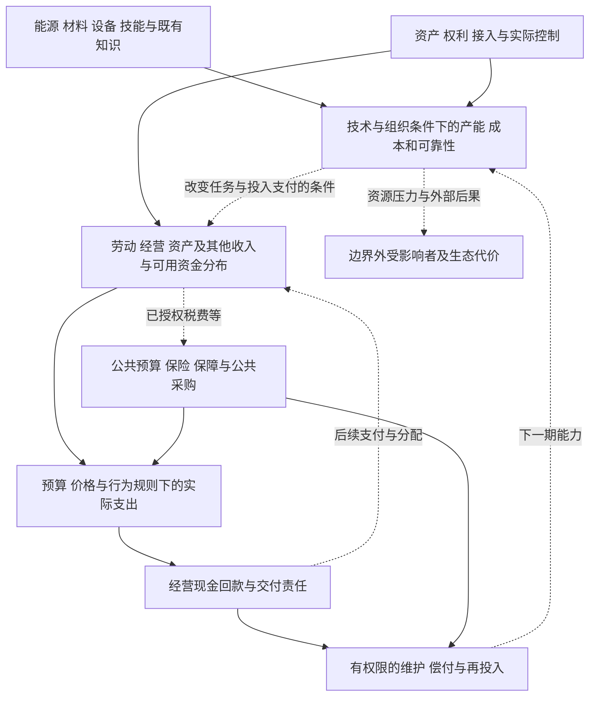

# AI时代的生产收入需求与再投入闭环

2026年11月12日。本页收束全书第五、六部分的解释接口，沿用已有生产、价格、信用、维护及技术研究。本轮不新增AI效果估计、现行税制说明或技术趋势调查。图中的联系是需要分别解释的路径，不把技术能力直接连成某个制度的必然结论。

## 同一框架中的三种约束

真实资源账记录能量、材料、设备、工时、技能、质量与负担；主体现金账记录实际收支、融资、到期支付与余额；权利及资产负债记录谁能使用、决定、取得回款并承担责任。三者相互影响，不能合并相加。物理上可生产、有人想用、有能力支付和愿意按某种合同付款，分别检查。

实线表示本框架必须登记的条件或资金联系，不是已经识别的普遍因果定律；虚线标需要单独解释的行为、制度或跨期作用。公共预算通过采购或维护委托等路径支付，同一笔资金不能沿两条箭头重复计算。收入支出联系与下一期反馈要用数据或动力学闭合，不能仅凭箭头宣布达到均衡。权利与公共授权本身的形成及正当性由第四部分承担。

## 数字知识服务与实体设备服务的对照

| 同一个问题 | 版本化知识检索服务 | 依赖机器人或其他设备的作业服务 |
|---|---|---|
| 实际交付 | 经核验的检索、引用、接口与期限内支持 | 达标作业、容量、可靠性与期限内维护 |
| 可复用部分 | 经许可的知识、代码、索引结构与方法 | 经许可的设计、软件、控制方法与作业知识 |
| 稀缺投入 | 算力、电力、审校、更新、运行及响应能力 | 设备、材料、场地、能源、备件、维修及操作能力 |
| 控制与回款 | 使用和经营许可、托管与接口接入、服务合同 | 设备使用和资产控制、调度、维护及服务合同 |
| 技术可能改变 | 创建、查询、核验、更新成本与共同错误 | 部分操作劳动、精度、产能、资本需求与维修方式 |
| 不能省略的约束 | 低复制成本不等于有可靠版本或免费托管 | 软件可复制不等于设备、材料与能源可复制 |
| 收入怎样进入 | 谁取得服务费、工资、经营净额和公共回流 | 谁取得劳动报酬、设备使用费、经营净额并担风险 |
| 如何持续 | 有实际付款或其他支持、已授权维护与接替 | 同时有现金、物理维修资源、能力和接替安排 |

这是两种分析场景，不是两个已上线AutoOS业务。实际参数需要记录，设备安全和法律责任须在具体应用中取得专门依据，本页不代替这些领域判断。

## 一次资金账闭合的反例

设A、B是两类资金接收组，企业F和公共预算G另列账户。每个场景从相同现金开始：A=40、B=40、F=100、G=20，总计200。企业本期先付80，其中参考场景劳动支付60、资产及服务支付20；较高产能场景分别为20和60。维护8已经包括在劳动支付中，不再重复扣款。

A按其付款前可用现金的80%购买，B按20%购买；这是假设的付款规则，包含初始余额，不是按工资、资本或贫富身份赋予固定人性。服务单价1，本期固定现金投入80，产能范围内不另设边际现金成本。B在这个简化聚合里没有后续供应商支出；现实必须拆出能源、设备、贷款、工资和利润，不能把全部服务收入当净财富。

| 彼此独立的场景 | 产能 | A购买 | B购买 | 公共购买 | 实际销售 | F期末现金 | G期末现金 |
|---|---:|---:|---:|---:|---:|---:|---:|
| 参考：支付60／20 | 100 | 80 | 12 | 0 | 92 | 112 | 20 |
| 较高产能：支付20／60 | 140 | 48 | 20 | 0 | 68 | 88 | 20 |
| 同上，另有已授权的B→公共预算→A转移20 | 140 | 64 | 16 | 0 | 80 | 100 | 20 |
| 同上，公共预算实际购买10 | 140 | 48 | 20 | 10 | 78 | 98 | 10 |

每笔支付同时记出款与收款，各场景期末总现金仍是200，所有余额非负；转移没有创造新资源，公共购买确实消耗既有预算。程序用有理数逐笔核验，见[核算](../../examples/ai-income-feedback-accounts.py)、[逐笔账](ai-income-cash-ledger.csv)和[结果](ai-income-account-results.json)。

本例说明在给定支付、产权收益和行为规则下，产能提高不保证实际销售或企业现金增加；不同收入分布与公共支出改变实际购买。它没有估计AI的真实工资、资本收入或消费倾向，也没有证明这两个公共方案最优。100／140是抽象合格服务量，不是知识服务和实体服务的共同物理单位。

图中的跨期机制尚未由这一单期账自动解出。要预测下一期，需要另给价格、工资、资产收入、库存、投资、信贷与行为调整的方程并检验；本轮完成的是结构责任闭合与一次资金守恒反例，不称作完整宏观均衡。

## 公共支持与物质边界放在哪里

第四部分四4说明公共授权、不能退出者与纠错；第五部分五3区分原始权利、收入约定、贡献归因和正当分配；五5保留货币信用与公共收支的多路径历史；五6连接保险、税费、转移、公共采购、账期和再投入；五7讨论开放成果支持。这里不预先选择税率、保障形式或统一分配公式。

能源、材料与环境约束放入一3的输入维护、五2的生产积累和六1的技术条件。现金账闭合不保证设备、电力、技能或生态承载足够；不能把账外代价视为零，也不能把局部效率提升直接当全社会净改善。完整资源或气候政策模型可留论文路线，正文涉及的关键限制不能因此省略。

## 对Open Business的有限交付

技术进步可能改变可复用部分、稀缺服务、资产控制和收入渠道。Open Business需要说明谁接受何种付费关系、哪些实收可回流、谁维护、何种权限允许调节预算，以及对实际可行替代方案有什么优势。免费使用与平台外经营不自动形成平台收入，社会购买力也不会由某个项目的公共池自动解决。

本框架支持将开放复用、服务竞争、持续维护和回报作共同制度设计；是否改善任务结果、分布和自主，仍按[五种方式比较](../03-competition-cooperation-distribution/institutional-financing-comparison.md)检验。若收益主要来自额外补贴、垄断入口或未计劳动，应修订归因；若别的安排更符合质量与开放目标，应保留它作为可行选择。

沿用依据：[生产与经济接口](../../reviews/33-organization-and-economic-interfaces.md)、[价格与收入](README.md)、[信用与维护](credit-investment-and-reinvestment.md)、[融资论证](financing-argument-map.md)、[技术杠杆](../06-technological-levers-and-organizational-evolution/README.md)。本次未增加原文读页，所有数值为本项目新设反例参数。
